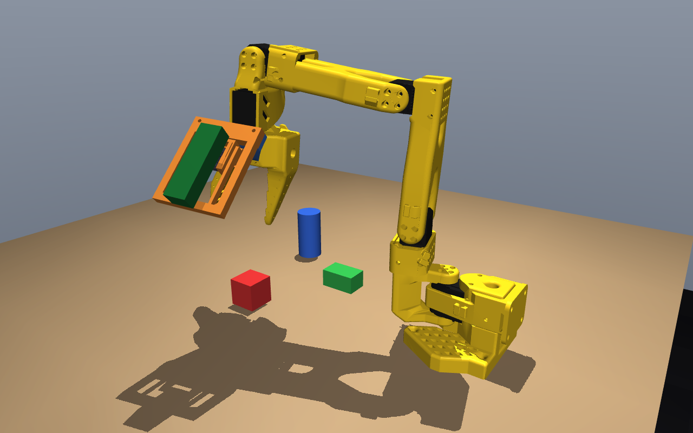
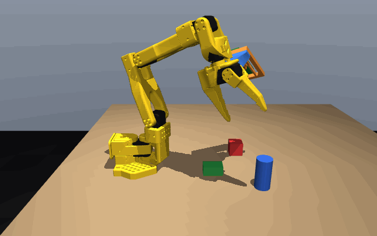
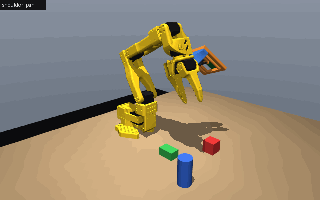
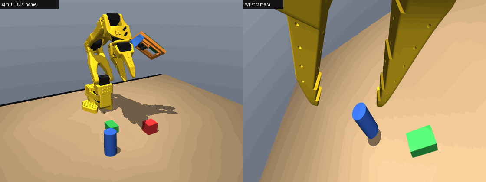
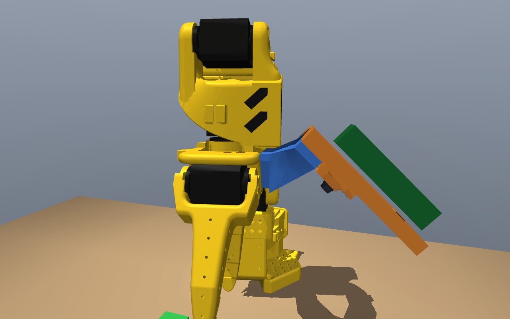
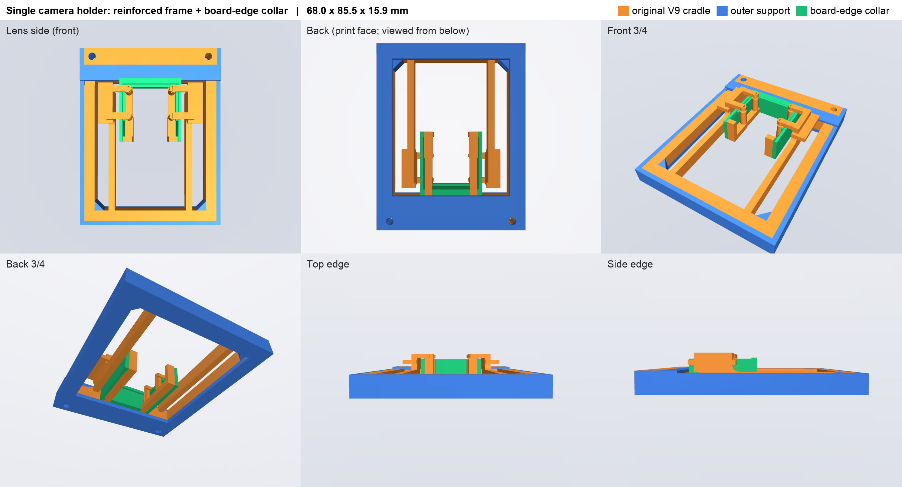
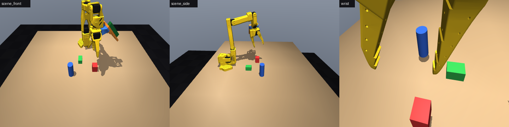
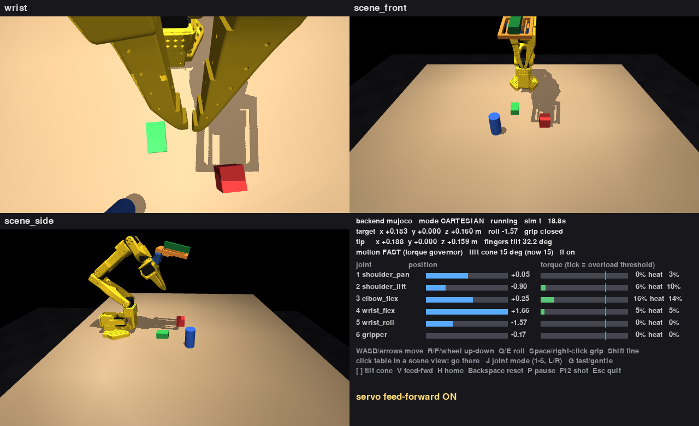

# Robotic Vision Project

Modifying the open-source **SO-101** robot arm to use components we already have, and running it in
simulation (Newton / MuJoCo, not LeRobot).



## Pictures

All from the simulation (MuJoCo render of `sim/model/workcell.xml`). Regenerate them with
`python sim/tools/render_media.py`.

| | |
|---|---|
|  |  |
| The follower, reaching while the camera circles it. | Each of the six servos in turn: pan, shoulder, elbow, wrist flex, wrist roll, gripper. |

**Scripted pick**, with the free camera on the left and the simulated wrist camera on the right. It uses the realistic
(soft) servo model with gravity/back-EMF feed-forward and grip-by-offset (`sim/scripts/pick_demo.py`):



| | |
|---|---|
|  |  |
| Gripper and wrist camera. The blue part is the wrist bracket, the orange part the camera holder, and the green part the ESP32-P4 board. | The single Camera Module 3 holder (`hardware/camera_mount/`). |

What the three simulated cameras see (two fixed scene cameras and the wrist camera):



The keyboard/mouse teleop window (`sim/scripts/teleop.py`):



## Layout

| Path | What | Edit? |
|---|---|---|
| `third_party/SO-ARM100/` | Upstream SO-101 design from [TheRobotStudio/SO-ARM100](https://github.com/TheRobotStudio/SO-ARM100) (Apache-2.0): STEP CAD, STL print files, URDF/MuJoCo models, optional mounts, BOM. Pinned commit in `UPSTREAM_COMMIT`. | No, mirror only |
| `third_party/hiwonder-so-arm101/` | Hiwonder's variant (HX-10HM/HX-30HM servos): manuals, servo protocol, print files, Rhino CAD, LeRobot patch | No, reference only |
| `docs/PLAN.md` | Build decisions, camera pipeline, open items and open decisions | Yes |
| `docs/BOM.md` | Parts ordered and still to buy, with links, prices and the power wiring | Yes |
| `docs/CONCEPTS.md` | Self-contained lessons on the ideas behind the arm (motors, control, IK, contact, camera) | Yes |
| `docs/datasheets/` | Datasheets + official CAD: servos, servo driver board, Camera Module 3, ESP32-P4 board/chip | No, reference only |
| `firmware/p4-uvc-camera/` | ESP32-P4 + Camera Module 3 → USB UVC webcam firmware (ESP-IDF). `host/` builds the same source for a PC with stand-in hardware, for the simulation | Yes |
| `firmware/components/` | Vendored IMX708 camera driver (Apache-2.0) used by the firmware | Carefully |
| `hardware/camera_mount/` | Single Camera Module 3 holder (from the stereo V9 beam, reinforced): STEP/STL + CadQuery build | Yes |
| `hardware/wrist_mount/` | Wrist bracket + camera placement study (gripper +y side, lens between the jaw tips) | Yes |
| `sim/` | Simulation (Newton/MuJoCo Warp + MuJoCo): follower with the mounted wrist camera, workcell, 3 cameras, keyboard/mouse **teleop** (fast: torque governor; optional load-aware IK), pick demo, vision check, servo load + fast-teleop studies, the **servo bus in the loop** (emulated HX-30HM servos behind a byte-level bus) and the **camera firmware in the loop** (the real firmware source built for the PC), both for debugging before the hardware exists. See `sim/README.md` | Yes (not `sim/model/`, which is generated) |
| `hub/` | The program that would run on the real machine: finds what is plugged in (arm, fixed cameras, a rover that only looks), works out where each is from what it sees, maps the place, and gives a language model one REST API to all of it. It is told nothing about the place. `hub/README.md` | Yes |
| `firmware/rover-bridge/` | The rover board's firmware: its servo bus over Wi-Fi, and wheels that stop by themselves when the link goes quiet. The core also builds for a PC, for the simulation | Yes |
| `docs/MULTI_DEVICE_PLAN.md`, `docs/MULTI_DEVICE_CHECKLIST.md` | The plan for several devices under one model, and what of it is done | Yes |
| `scripts/` | `sync_so_arm100.sh`: re-sync the upstream mirror. `run_hub.py`: the hub on real ports (not yet tried on hardware) | |

Keep `third_party/` and `docs/datasheets/` pristine so we can always diff our
changes against the originals. Copy a file into `hardware/` or `sim/` before changing it.

## Large files

STL / STEP / 3MF / 3DM / PDF files are stored with **Git LFS**. Install it before cloning:

```bash
brew install git-lfs   # or your package manager
git lfs install
git clone https://github.com/elliot-at-liminalnook/robotic-vision-project.git
```

Without LFS you get small pointer files instead of meshes, and simulation won't load.

## Quick start: drive the simulated arm

```bash
python sim/scripts/teleop.py                    # keyboard + mouse, all three cameras (MuJoCo backend)
python sim/scripts/teleop.py --backend newton   # Linux: Newton / MuJoCo Warp
python sim/scripts/teleop.py --bus              # commands go through a simulated servo bus to emulated servos
python sim/scripts/teleop.py --camera-fw        # the wrist view comes through the camera firmware, built for this PC
python sim/scripts/teleop.py --cables           # with the arm's wires in the model (servo leads, camera USB cable)
python sim/scripts/sim_api.py                   # REST API so a language model (or any program) can drive the arm
python sim/scripts/sim_api.py --scene bench --window   # the harder scene and its task; bench_solution.py solves it
```

Details, verified results and backend notes: `sim/README.md`. Decisions so far: `docs/DECISIONS.md`.

## Several devices, one model

The arm, fixed cameras and a small tabletop rover (two cameras on a head that turns and tilts; it only
looks) can be run together by one language model through the hub (`hub/`). The hub is given serial
ports, cameras and a clock, and nothing about the place: it finds what is plugged in, works out where
each device is from what the cameras see, builds a map from the rover's two cameras, refuses moves
that would hit what it has mapped, and can measure its own lenses, camera pair and wheels.

```bash
python sim/scripts/run_system.py --scene shelf --survey   # a simulated world, the hub on its ports, both REST APIs
curl http://127.0.0.1:8765/                               # the hub's guide: what a model is given
python sim/scripts/solve.py --list                        # the tasks (8 scenes, 18 tasks) and which have a reference solution
python sim/scripts/solve.py shelf on_the_shelf            # solve one through the hub's API alone; a referee with the truth scores it
```

Where it stands (`docs/MULTI_DEVICE_CHECKLIST.md` has every box):

- **Done in simulation:** discovery, locating every device, the survey and map, safety, self-calibration,
  the rover board's firmware (its portable core, run against emulated servos), and reference solutions
  for 16 of the 18 tasks (14 done as the referee sees it; 2 say why they cannot be).
- **Written, not run:** `sim/scripts/model_run.py` gives a task to a Claude model through the same API
  and has the referee score it. It needs `pip install anthropic` and credentials, and is billed per run.
- **Not yet on hardware:** `scripts/run_hub.py` and `hub/real.py` (USB serial, the rover's network
  link, UVC cameras) have only been tried against a stand-in board on this machine; the rover board's
  ESP-IDF build has not been built or flashed.

Run the tests with `pytest sim/tests` (about 3 minutes).

## View the upstream arm

Our simulation lives in `sim/` (see `sim/README.md`). The upstream model can still be viewed directly:

The upstream MuJoCo scene works as-is (verified with MuJoCo 3.10.0, Python 3.13):

```bash
pip install --only-binary :all: mujoco   # Intel Macs: MuJoCo 4.x has no x86_64 wheel; this resolves to 3.10.0
python -m mujoco.viewer --mjcf=third_party/SO-ARM100/Simulation/SO101/scene.xml
```

The model has 6 actuated joints: `shoulder_pan`, `shoulder_lift`, `elbow_flex`,
`wrist_flex`, `wrist_roll`, `gripper`.

Known gaps for this project:
- `so101_new_calib_camera.xml` adds the wrist-camera *mesh* but defines **no MuJoCo camera**,
  so there's no simulated camera image yet.
- The sim uses STS3215 geometry and motor parameters. Hiwonder's HX-servo variant has no sim model.

## Licensing

- `third_party/SO-ARM100/`: Apache-2.0 (see its `LICENSE`).
- `third_party/hiwonder-so-arm101/` and `docs/datasheets/`: manufacturer documents with no
  stated license, included for reference; this repo is public, so remove them if a vendor objects.
