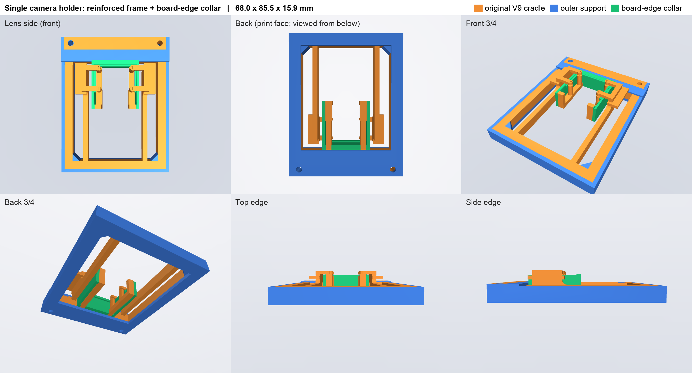
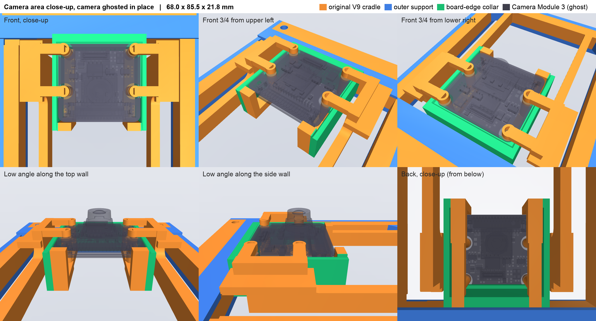

# camera_mount: single Camera Module 3 holder

One camera cradle cut from the stereo project's V9 `camera_beam`
(`~/Projects/esp32-stereo-camera/outputs/stereo-prototype-v9`), reinforced.
Used for the wrist camera (with `../wrist_mount`) and for the fixed scene camera(s).




| | |
|---|---|
| Size | 68.0 × 85.5 × 16.0 mm, one solid, ~33 g solid PLA (~15 g at typical infill) |
| Camera | Raspberry Pi Camera Module 3 (Wide), landscape, FFC connector at the bottom |
| Fixing | Snap-in: pull both side paddles out, drop the camera onto the pins/pads, release. No tools |
| Mounting | Two M3 clearance holes in the top band, 56 mm apart (holder x = ±28, y = 29 mm) |
| Print | Flat on the back face (z = −6). The hook caps overhang; use supports as V9 did |

## What's in it

- **Original V9 cradle (orange in the renders), unchanged:** the two spring arms with hook caps over the
  camera's mounting holes, the side release paddles (4 mm travel), two diagonal locating pins, four support
  pads and two lower-corner shelves.
- **Outer support (blue):** side and bottom rails +2 mm on the outside, a solid top band (replaces the stereo
  carrier latch) with the M3 holes, a 2 mm back flange, and bottom corner gussets.
- **Board-edge collar (green):** guide walls 0.3 mm outside the PCB on the left, right and top (to z 7.5, with a
  lead-in chamfer), and back ledges under those edges flush with the pads. The bottom edge stays open for the
  connector and ribbon.

## Build

`build_single_holder.py` (CadQuery 2.x) regenerates everything from `source/`:
`camera_holder_single.step/.stl`, the `preview_*.stl` render pieces and `build_report.json`.

```bash
~/Projects/esp32-stereo-camera/work/cad-setup/venv/bin/python3 hardware/camera_mount/build_single_holder.py
```

It asserts:
- the holder is one solid;
- no added material overlaps either spring's moving pieces, swept through their full 4 mm release;
- nothing touches the Camera Module 3 reference model.

## Not yet verified

Printed fit and snap force: V9's own notes say the same; neither was tested on a print.
