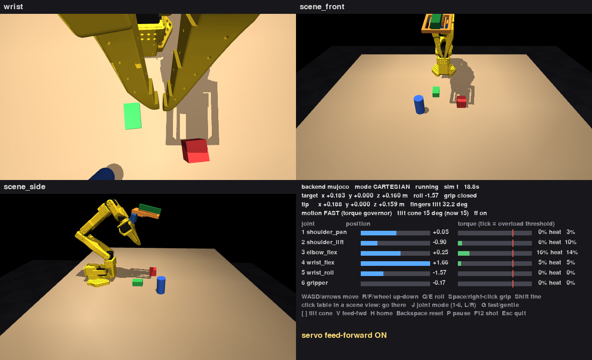
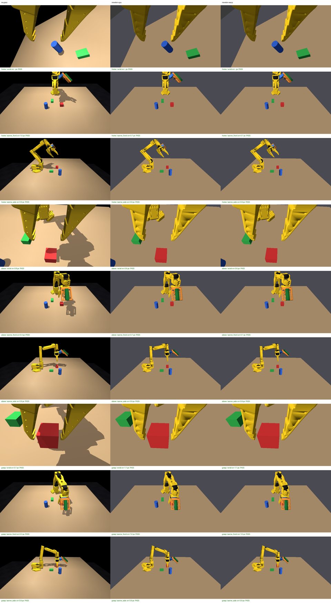
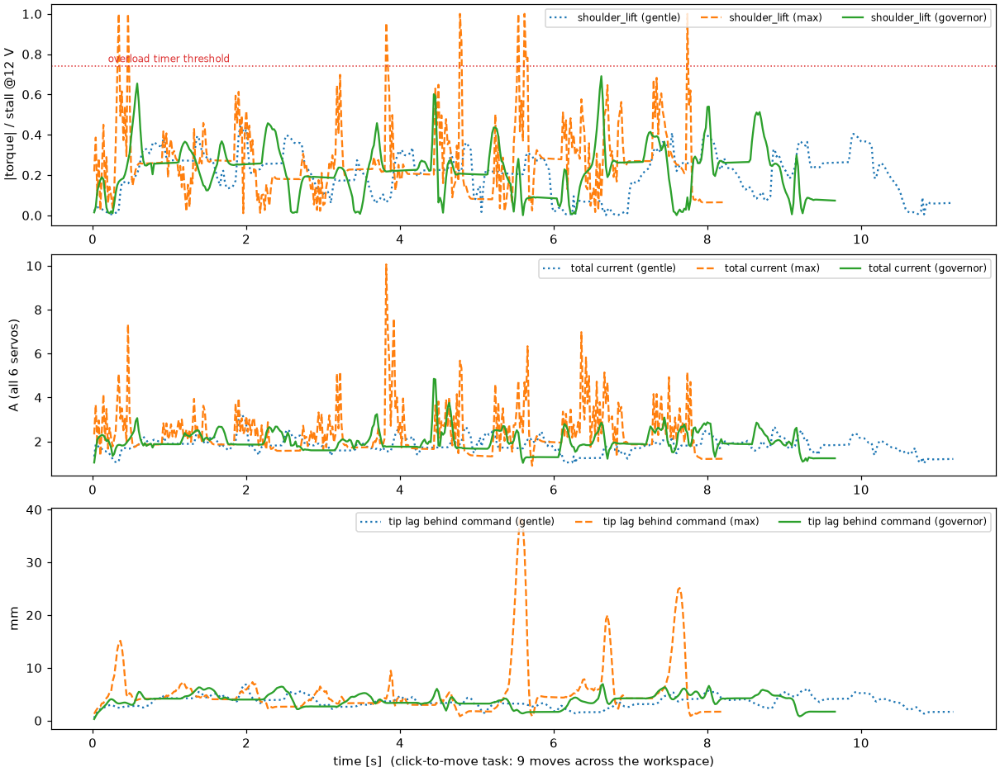
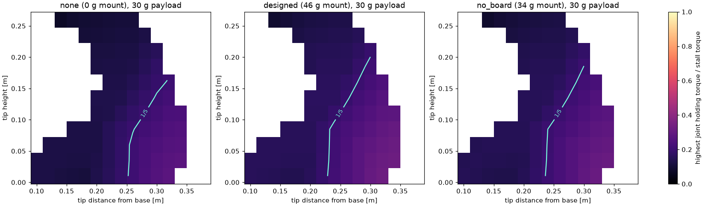

# sim/: SO-101 follower simulation (Newton + MuJoCo Warp)

A simulation of our follower arm, its mounted wrist camera, the workcell and
the fixed cameras. It's built to run on
**[Newton](https://github.com/newton-physics/newton) with `SolverMuJoCo` on the
MuJoCo Warp backend** (GPU). The same model also runs in plain MuJoCo, for
machines Newton doesn't support.

```
sim/
├── config/cameras.toml     # camera intrinsics + poses (wrist pose -> hardware/wrist_mount)
├── config/servos.toml      # HX-30HM limits @ 12 V supply, torque-governor settings, encoder mapping
├── scene/workcell.xml      # hand-written: table, objects, lights, physics options
├── tools/build_model.py    # generates model/ from the pristine upstream MJCF + our hardware
├── model/                  # GENERATED (committed): robot + workcell MJCF and meshes
├── so101sim/               # runtime: backends, IK (strict + load-aware), servo model, dynamics, governor
└── scripts/
    ├── teleop.py           # drive the arm with keyboard + mouse, all three cameras live
    ├── pick_demo.py        # scripted pick: end-to-end physics check
    ├── vision_check.py     # every camera sees what it should, per backend
    ├── servo_load_study.py # can the servos carry the wrist camera?
    └── fast_teleop_study.py # torque governor + load-aware IK vs the gentle profile
```

## Run it

| Machine | Backend | Notes |
|---|---|---|
| Linux + NVIDIA GPU | `newton`, solver `warp` (default with CUDA) | The target: MuJoCo Warp |
| Linux, CPU only | `newton`, solver `cpu` | MuJoCo C backend through Newton; same model and cameras |
| Intel Mac | `mujoco` | Warp has no x86_64 macOS build, so Newton can't install. Newton runs in the Lima VM `newton-sim` (CPU) |

```bash
# Linux
python3 -m venv ~/newton-venv && ~/newton-venv/bin/pip install -r sim/requirements.txt
~/newton-venv/bin/python sim/scripts/teleop.py --backend newton          # --solver warp|cpu

# Anywhere MuJoCo runs (Intel Mac: pip install --only-binary :all: mujoco pygame -> MuJoCo 3.10.0)
python sim/scripts/teleop.py                                              # MuJoCo backend
python -m mujoco.viewer --mjcf=sim/model/workcell.xml                     # plain viewer
```

## teleop.py: keyboard + mouse control



The window shows the wrist, scene_front and scene_side cameras plus a status panel:
- target vs actual tip and the fingers' tilt;
- motion mode and tilt cone;
- per joint: position, and predicted torque (% of stall; the red tick is the servo's overload threshold) with
  heat (RMS torque vs the continuous rating).

| Input | Cartesian mode (default) | Joint mode (`J`) |
|---|---|---|
| `W`/`S` or ↑/↓ | tip forward / back (+x/−x) | — |
| `A`/`D` or ←/→ | tip left / right (+y/−y) | move the selected joint |
| `R`/`F`, mouse wheel | tip up / down | wheel moves the selected joint |
| `Q`/`E` | wrist roll | — |
| `1`–`6` | — | select a joint |
| left-click the table in a scene view | move the tip above that point | — |
| `Space` or right-click | open / close the gripper | same |
| `Shift` | fine (×0.2) motion | same |
| `G` | FAST (torque governor, default) / GENTLE (fixed profile) | same |
| `V` | servo feed-forward on (default) / off | same |
| `[` / `]` | tilt cone for load-aware IK, 0–25° (default 0°) | — |
| `H` / `Backspace` / `P` / `F12` / `Esc` | home / reset scene / pause / screenshot / quit | same |

- **Always enforced:** joint limits, the camera-safe wrist roll range and a minimum tip height.
- **Motion** (details in [docs/FAST_TELEOP_FINDINGS.md](docs/FAST_TELEOP_FINDINGS.md)):
  - **FAST:** the torque governor commands the fastest smooth motion the 12 V HX-30HMs can follow, staying
    clear of overload protection and heat limits. Keys move the tip at 0.25 m/s.
  - **GENTLE:** the fixed 2.75 rad/s, 8 rad/s² profile, with keys at 0.10 m/s.
  - **Clicks and `H`** travel a straight line, paced by the measured arm. Jumping straight to the far joint
    angles could drive the gripper into the table.
- **IK:** keeps the fingers as close to straight down as the arm allows. With a tilt cone, they may tilt that
  much (above 10 cm only) to lower holding torque. Unreachable targets are refused, with a message.
- **Servo compensation** (`so101sim/command.py`, also used by `pick_demo`):
  - **Feed-forward:** every arm command gets q + (gravity torque + back-EMF × commanded speed) ÷ servo
    stiffness. `V` toggles it, to show the droop it removes (≈5 mm at home).
  - **Grip-by-offset:** when the jaws stall on an object, the gripper holds 3° past contact (≈33 % of stall)
    instead of stalling fully closed into the servo's overload protection. The panel shows "grip HOLD".
- **Newton on CPU:** add `--render-every 5` (or more), since ray-traced cameras are slow without a GPU.

`--selftest` runs the window headless with scripted keys and mouse events, and checks that:
- `W` moves the tip forward;
- a table click lands within 15 mm;
- the wheel lowers the tip;
- `Space` closes the gripper;
- joint mode moves a joint;
- the load panel reports torque;
- `G` toggles the speed mode;
- `]` widens the tilt cone;
- `H` travels home;
- the cone applies above 10 cm;
- feed-forward removes droop (`V`).

## Verified results (2026-11-08)

| Check | MuJoCo 3.10 (Mac) | Newton, MuJoCo C (VM) | Newton, MuJoCo Warp on CPU (VM) |
|---|---|---|---|
| `pick_demo`: cube lifted 10 cm and held (realistic servo loop + feed-forward) | ✅ 0.1026 m | ✅ 0.1026 m | ✅ 0.1026 m |
| `pick_demo --no-feedforward` (same servos, no compensation) | ❌ not lifted | ❌ not lifted | not run |
| `vision_check`: cube where predicted, all cameras × 3 poses | ✅ ≤ 1.0 px | ✅ ≤ 1.1 px | ✅ ≤ 1.1 px (before the servo-loop change; not rerun) |
| `teleop --selftest` | ✅ 11/11 | ✅ 11/11 (`--render-every 5`) | not run (too slow on CPU) |



`vision_check --compare` sheet. Columns are MuJoCo, Newton-CPU and Newton-Warp; rows are the poses × cameras.
Newton's ray-traced renders have flatter lighting, but the geometry agrees to about 1 px.

The MuJoCo Warp path is the GPU code running on Warp's CPU device (about 0.02× real time). Its speed on the GPU
PC is not measured yet.

## Servo load study: can the HX-30HM carry the wrist camera?

**Yes, with large margins.** See [docs/SERVO_LOAD_FINDINGS.md](docs/SERVO_LOAD_FINDINGS.md), plus the full tables
in [docs/SERVO_LOAD_STUDY.md](docs/SERVO_LOAD_STUDY.md) (`scripts/servo_load_study.py`, ~15 min).
- **Static load:** the 46 g mount raises worst-case holding torque by about 4–5 % of stall (shoulder: 28 → 32 %
  with a 30 g payload). It never reaches the 80 % overload trigger.
- **Real limits:** motion speed and grip torque matter more than the camera. The sim gripper is limited to 50 %
  torque.
- **Servo model:** `so101sim/servo_model.py` is a realistic torque-controlled HX-30HM for studies like this:
  voltage saturation at the supply, back-EMF, a PD position loop, overload protection and current. Engine joint
  damping is zeroed under it; the first study run double-counted it (corrected).

## Fast teleop: torque governor + load-aware IK

See [docs/FAST_TELEOP_FINDINGS.md](docs/FAST_TELEOP_FINDINGS.md) and the tables in
[docs/FAST_TELEOP_STUDY.md](docs/FAST_TELEOP_STUDY.md) (`scripts/fast_teleop_study.py`, ~90 s). HX-30HM on a 12 V
bench supply:
- **Governor vs the gentle profile:**
  - click-to-move 18 % faster (6.97 vs 8.5 s), with lower peak torque;
  - keyboard at 0.25 m/s tracks to 16 mm mean vs 37 mm;
  - no overload trips, even with a +40 % mass / 150 g model error or the servo loop 4× stiffer or softer.
- **Load-aware IK (15° cone):**
  - shoulder holding torque 8 % lower on average, up to 45 %, mostly below 10 cm where grasps need
    straight-down fingers;
  - so the default cone is 0°.





## What changed vs upstream (tools/build_model.py)

Upstream: `third_party/SO-ARM100/Simulation/SO101/so101_new_calib.xml`.

1. **Jaw collision.** Engines collide a mesh as its convex hull. Upstream's fixed jaw is one mesh with the wrist
   housing, so its hull fills the space between the jaws: **30 of 60 probe points in the gripping gap were
   inside it**. Both jaw meshes are replaced by CoACD convex decompositions (16 + 10 hulls). The generator fails
   the build if any hull intrudes into the gap (now 0/60).
2. **Finger pads.** The jaws' inner faces are stepped: flat lands at x = ∓7.9 / 9.9 / 11.6–11.9 mm, measured by
   ray casting. Each land gets a thin box pad, 0.5 mm proud, with friction 1.0 and torsional friction. That
   friction assumes rubber/TPU grip pads on the real jaws too; bare PLA is ~0.3–0.4.
3. **Actuators.** Torque limit ±3.18 N·m (HX-30HM stall at the 12 V supply); gripper ±1.59 N·m (50 % torque-limit
   register).
   - **Position loop: realistic, not upstream's.** Upstream SO-101 (and MuJoCo Menagerie) use kp 998 / kv 2.73,
     derived by treating the servo's P register as volts per degree with an assumed 1 Ω winding. That's
     ~20× stiffer than an identified servo of this family.
   - We use kp = stall / 9° = 20.2 N·m/rad and kv 0, with the motor's back-EMF as joint damping
     (0.534 N·m·s/rad), from `config/servos.toml [follower.position_loop]`.
   - 9° is a prior (BAM's STS3215 fit ≈9–10°, Open Duck Mini ≈14°) until the HX servos are measured.
   - Friction loss and armature stay upstream's.
   - At this stiffness the arm droops under gravity, so every command gets feed-forward (below).
   - See [../docs/POLICY_TRAINING_IDEAS.md](../docs/POLICY_TRAINING_IDEAS.md) B0/B7.
4. **Wrist camera assembly.** The bracket, camera holder, Camera Module 3 and ESP32-P4 board from
   `hardware/wrist_mount` are a welded child body of the gripper:
   - 46 g, with collision shapes;
   - the `wrist` camera at the lens pose from `wrist_mount_pose.json`.
5. **Fixed cameras.** `scene_front` and `scene_side` (`cameras_world.xml`), from `config/cameras.toml`.
6. **Workcell.** Table (top at z = 0) and three PLA-sized objects. Elliptic friction cones with `impratio = 10`,
   the `implicitfast` integrator and a 2 ms step.

## Things the engine doesn't model, done in `so101sim`

- **Servo top speed and torque.** Position actuators have no velocity limit. Teleop shapes commands with the
  torque governor (`governor.py`, using `dynamics.py`) or `ProfileLimiter`. `GoalInterpolator` spreads each
  30 Hz IK goal over a frame. `SlewLimiter` is a plain speed cap.
- **Camera-safe wrist roll.** `config.wrist_roll_range()` gives −2.74…+0.80 rad. Larger positive roll swings the
  side-mounted camera into the shoulder near the base. The range spans π, so every top-down jaw orientation is
  still reachable. Enforced by `pick_demo` and `teleop`.
- **Encoder mapping.** `ServoMap` converts servo ticks (0–4095) to radians; `zero_ticks`/`direction` are
  placeholders until measured.
- **Lens model (Newton only).** Rays are generated from the OpenCV intrinsics + distortion, so a calibrated lens
  is reproduced. MuJoCo renders an undistorted pinhole with the same vertical FOV. With the current
  zero-distortion placeholders, both should agree pixel for pixel, and `vision_check` confirms they do.

## Grasping notes

- **TCP.** Upstream's `gripperframe` site is on the fixed jaw's face. `pick_demo.solve_grasp` puts the object
  centre half its width plus a **4 mm clearance** in from the fixed pad, then the moving jaw closes it the rest
  of the way.
  - With zero clearance, the fixed jaw sometimes landed on the cube's edge on the way down and pushed it, and
    the grasp then failed.
  - Measured on a 3 s hold: 0 mm clearance held 0.6 s at the safe roll; 2–6 mm held the full 3 s at both rolls.
- **Reach.** Straight-down grasps are only reachable fairly low over the table. Higher up the fingers tilt up to
  ~10–30°, because `wrist_flex` hits its limit. `ArmIK` keeps the tip position exact and tilts as little as
  possible.

## Placeholders to replace with measurements

- **Intrinsics** (`cameras.toml`) are datasheet-derived: f = 2.75 mm, 2.8 µm binned pixels at 1920×1080 →
  fx = fy ≈ 982 px, no distortion. Calibrate each camera with a checkerboard.
- **Fixed camera poses:** measure the real stands with a marker board.
- **Servo dynamics:** fit gains, friction and backlash to real HX-30HM step responses. That gives `ServoSpec`
  `sat_error_deg` / `d_time_s` and the governor's `bandwidth_rad_s`.
- **Object masses and frictions** are estimates.

Re-run `python sim/tools/build_model.py` after changing configs or hardware. CoACD results are cached in
`sim/.cache/`, so re-runs take seconds.
