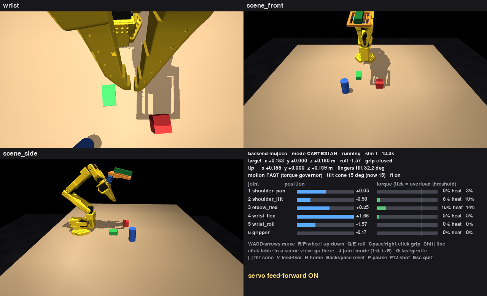
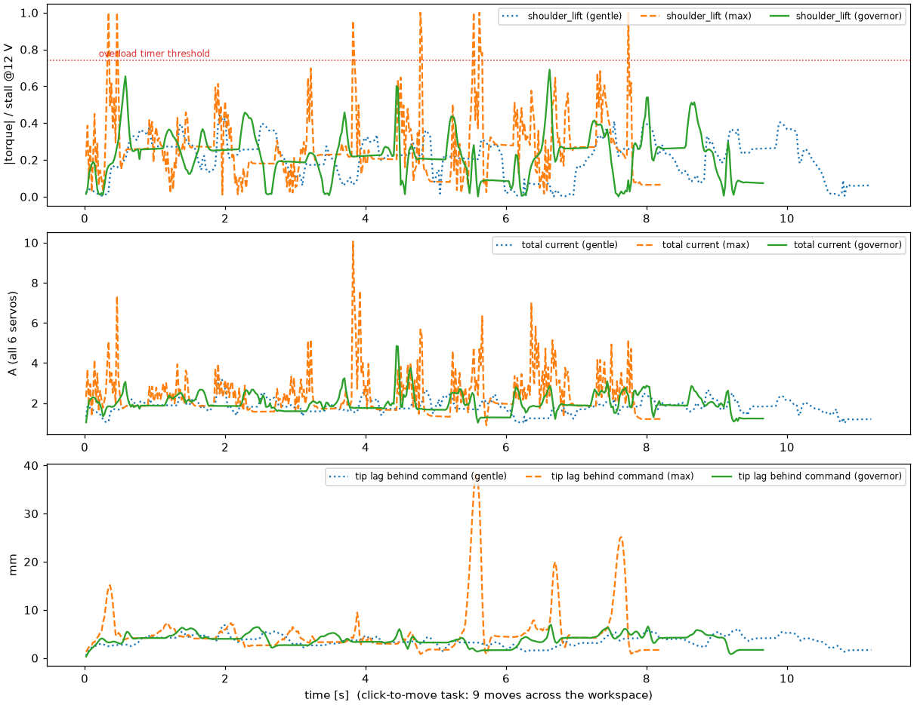
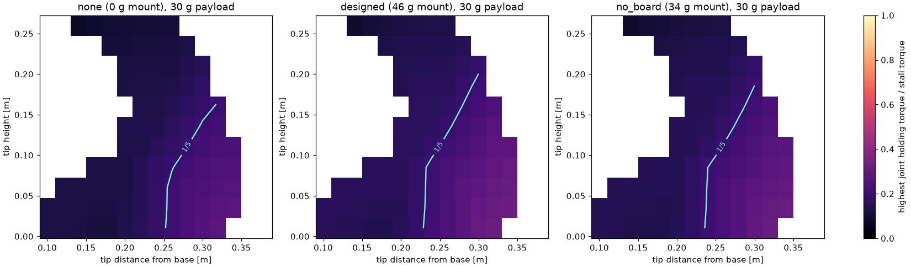

# sim/: SO-101 follower simulation (Newton + MuJoCo Warp)

A simulation of our follower arm, its mounted wrist camera, the workcell and
the fixed cameras. It's built to run on
**[Newton](https://github.com/newton-physics/newton) with `SolverMuJoCo` on the
MuJoCo Warp backend** (GPU). The same model also runs in plain MuJoCo, for
machines Newton doesn't support.

```
sim/
├── config/cameras.toml     # camera intrinsics + poses (wrist pose -> hardware/wrist_mount)
├── config/servos.toml      # HX-30HM limits @ 12 V supply, torque-governor settings, encoder mapping
├── config/safety.toml      # limits of the command filter and the physics monitor
├── config/cables.toml      # the wires: which connector to which, lengths, clips, stiffness guesses
├── scene/workcell.xml      # hand-written: table, objects, lights, physics options
├── scene/bench.xml         # hand-written: the harder scene (drawer, bins, platform, peg and socket) for the bench task
├── tools/build_model.py    # generates model/ from the pristine upstream MJCF + our hardware
├── model/                  # GENERATED (committed): robot + workcell MJCF and meshes
├── so101sim/               # runtime: backends, IK (strict + load-aware), servo model, dynamics, governor
│   ├── bus/                # servo bus at byte level: controller's driver + emulated HX-30HM servos and wire
│   ├── bus_backend.py      # MuJoCo with the servo bus in the loop (teleop.py --bus)
│   ├── camera_fw.py        # the camera firmware built for the PC, fed by the renderer (teleop.py --camera-fw)
│   ├── safety.py           # command filter: the last stage before the servos, in every backend
│   ├── monitor.py          # physics monitor: overlaps, speeds, objects through the table, every step
│   ├── cables.py           # the arm's wires as part of the model (teleop.py --cables)
│   └── tasks.py            # tasks: a description and goals checked against the simulation's state
├── tests/                  # pytest: invariants, fuzzing, config/model/docs consistency (see "Tests")
└── scripts/
    ├── teleop.py           # drive the arm with keyboard + mouse, all three cameras live
    ├── sim_api.py          # REST API: the same controller, driven by a language model or any program
    ├── bench_solution.py   # the bench task done through that API: the proof that it can be done
    ├── pick_demo.py        # scripted pick: end-to-end physics check
    ├── vision_check.py     # every camera sees what it should, per backend
    ├── servo_load_study.py # can the servos carry the wrist camera?
    └── fast_teleop_study.py # torque governor + load-aware IK vs the gentle profile
```

## Run it

| Machine | Backend | Notes |
|---|---|---|
| Linux + NVIDIA GPU | `newton`, solver `warp` (default with CUDA) | The target: MuJoCo Warp |
| Linux, CPU only | `newton`, solver `cpu` | MuJoCo C backend through Newton; same model and cameras |
| Intel Mac | `mujoco` | Warp has no x86_64 macOS build, so Newton can't install. Newton runs in the Lima VM `newton-sim` (CPU) |

```bash
# Linux
python3 -m venv ~/newton-venv && ~/newton-venv/bin/pip install -r sim/requirements.txt
~/newton-venv/bin/python sim/scripts/teleop.py --backend newton          # --solver warp|cpu

# Anywhere MuJoCo runs (Intel Mac: pip install --only-binary :all: mujoco pygame -> MuJoCo 3.10.0)
python sim/scripts/teleop.py                                              # MuJoCo backend
python -m mujoco.viewer --mjcf=sim/model/workcell.xml                     # plain viewer
```

## teleop.py: keyboard + mouse control



The window shows the wrist, scene_front and scene_side cameras plus a status panel:
- target vs actual tip and the fingers' tilt;
- motion mode and tilt cone;
- per joint: position, and predicted torque (% of stall; the red tick is the servo's overload threshold) with
  heat (RMS torque vs the continuous rating).

| Input | Cartesian mode (default) | Joint mode (`J`) |
|---|---|---|
| `W`/`S` or ↑/↓ | tip forward / back (+x/−x) | — |
| `A`/`D` or ←/→ | tip left / right (+y/−y) | move the selected joint |
| `R`/`F`, mouse wheel | tip up / down | wheel moves the selected joint |
| `Q`/`E` | wrist roll | — |
| `1`–`6` | — | select a joint |
| left-click the table in a scene view | move the tip above that point | — |
| `Space` or right-click | open / close the gripper | same |
| `Shift` | fine (×0.2) motion | same |
| `G` | FAST (torque governor, default) / GENTLE (fixed profile) | same |
| `V` | servo feed-forward on (default) / off | same |
| `[` / `]` | tilt cone for load-aware IK, 0–25° (default 0°) | — |
| `H` / `Backspace` / `P` / `F12` / `Esc` | home / reset scene / pause / screenshot / quit | same |
| `X` | **STOP**: drop the move under way and hold the arm where it is | same |
| `T` | torque off (the arm goes limp) / back on, holding where it then lies | same |

- **Always enforced:** joint limits, the camera-safe wrist roll range and a minimum tip height (in joint mode,
  a jog that would take the tip below it is refused).
- **Stall guard:** if an arm joint stays more than 12° behind its command for 0.4 s, something is in the way
  (the table, an object or the arm itself). The goal is pulled back to where the arm is, so the servo doesn't
  sit at full torque. The tip-height limit only covers the tip; this covers everything else.
- **Stop path** (`Teleop.freeze`, `set_torque`, `shutdown`; the switch itself is each backend's
  `torque_off()` / `torque_on()`):
  - **`X` freezes.** The goal becomes the pose the arm is in and the command starts again from there, at
    rest. Torque stays on, so the arm holds and a gripped object stays gripped. Movement keys still held
    down do nothing until they are let go.
  - **`T` switches torque off.** The arm goes limp and sags. While it is off, nothing is commanded: keys
    and clicks are refused, and no goal is written to the bus (on Feetech firmware a goal write switches
    torque back on). `T` again switches it on holding the pose the encoders report at that moment;
    `Backspace` (reset) also switches it on.
  - **Every way out switches torque off:** `Esc`, closing the window, an exception, Ctrl-C and `kill`
    (SIGTERM) all leave through one `finally`. The exit report says whether it was confirmed.
  - **Confirmed, not assumed.** Over the bus the switch is a broadcast, which has no reply. Each servo's
    register is read back, and a servo that missed it is written singly. One that cannot be reached is
    named ("TORQUE OFF NOT CONFIRMED, cut the power"). `enable()` confirms the goals the same way before
    it switches torque on.
  - **What it does not cover:** a dead computer, a dead bus, or `kill -9`. The servos then hold their last
    goal. That takes a switch on the 12 V lead.
- **Modes:** a table click or `H` in joint mode switches to Cartesian mode. Pausing (`P`) freezes the target as
  well as the physics.
- **Motion** (details in [docs/FAST_TELEOP_FINDINGS.md](docs/FAST_TELEOP_FINDINGS.md)):
  - **FAST:** the torque governor commands the fastest smooth motion the 12 V HX-30HMs can follow, staying
    clear of overload protection and heat limits. Keys move the tip at 0.25 m/s.
  - **GENTLE:** the fixed 2.75 rad/s, 8 rad/s² profile, with keys at 0.10 m/s.
  - **Clicks and `H`** travel a straight line, paced by the measured arm. Jumping straight to the far joint
    angles could drive the gripper into the table.
- **IK:** keeps the fingers as close to straight down as the arm allows. With a tilt cone, they may tilt that
  much (above 10 cm only) to lower holding torque. Unreachable targets are refused, with a message.
- **Servo compensation** (`so101sim/command.py`, also used by `pick_demo`):
  - **Feed-forward:** every arm command gets q + (gravity torque + back-EMF × commanded speed) ÷ servo
    stiffness. `V` toggles it, to show the droop it removes (≈5 mm at home).
  - **Grip-by-offset:** when the jaws stall on an object, the gripper holds 3° past contact (≈33 % of stall)
    instead of stalling fully closed into the servo's overload protection. The panel shows "grip HOLD". It
    lets go if the object is lost.
- **Newton on CPU:** add `--render-every 5` (or more), since ray-traced cameras are slow without a GPU.

`--selftest` runs the window headless with scripted keys and mouse events, and checks that:
- `W` moves the tip forward;
- a table click lands within 15 mm;
- the wheel lowers the tip;
- `Space` closes the gripper;
- joint mode moves a joint;
- the load panel reports torque;
- `G` toggles the speed mode;
- `]` widens the tilt cone;
- `H` travels home;
- the cone applies above 10 cm;
- feed-forward removes droop (`V`).

## Servo bus in the loop (`teleop.py --bus`)

For debugging the controller against the hardware's interface before the hardware exists. Instead of
handing joint targets to the physics engine, the controller sends the bytes it would send to the real arm:

```
teleop / pick_demo ── packets ──▶ simulated wire ──▶ 6 emulated HX-30HM ── torque ──▶ MuJoCo
  (BusArm, FeetechBus) ◀─ packets ─                    (registers + control loop) ◀─ angle, speed ─
```

```bash
python sim/scripts/teleop.py --bus                     # same window and keys; a bus report is printed on exit
python sim/scripts/teleop.py --bus --bus-drop 0.05     # lose 5 % of the servos' replies
python sim/scripts/teleop.py --bus --bus-trace 40      # also print the last 40 frames on the wire
```

| Part | File | What it is |
|---|---|---|
| Packets | `so101sim/bus/protocol.py` | Framing, checksum, a stream parser that resynchronises on garbage |
| Driver | `bus/driver.py` | **Controller code.** PING, READ, WRITE, SYNC_READ, SYNC_WRITE over any port; every reply checked; retries; counters |
| Arm | `bus/arm.py` | **Controller code.** Joints in radians ↔ servo ticks. `connect()` only reads and refuses to go on unless the registers look like the HX table; `configure()`; `enable(q)` |
| Register table | `bus/hx_registers.py` | HX-30HM table V3.7, checked against the vendor spreadsheet by a test |
| Servo | `bus/servo_emu.py` | **Our stand-in for the closed servo firmware**: register memory, saved vs volatile registers, lock flag, REG_WRITE/ACTION, the position loop (`servo_model.py`), torque limit, overload protection, feedback registers |
| Wire | `bus/wire.py` | Byte timing at the baud rate, servo response delay, USB latency, reply order of a SYNC_READ, injected faults, a frame trace |
| Backend | `bus_backend.py` | Joins the above to MuJoCo behind the usual backend API |

What it shows that the direct backends can't:

- **Time on the bus.** One encoder read of six servos takes about 4 ms and a full feedback read about 5 ms
  (with the placeholder USB latencies), so a reading is that old when the controller gets it. Teleop uses
  about 15 % of the wire's capacity at 1 Mbaud.
- **What a lost or corrupted packet does** to the control loop (`--bus-drop`, or `drop_command_prob`,
  `corrupt_prob` on `BusBackend`).
- **Set-up mistakes**, reported at connect: six new servos that all answer as id 1, a missing servo, a servo
  at another baud rate, an adapter that echoes, a servo with a different register layout.
- **Register mistakes.** A write to a read-only or undocumented register, or outside a register's range, is
  listed in the report. A test requires that a teleop session produces none.
- **Encoder resolution**: positions are whole ticks (0.088°), in both directions.

Limits, stated plainly:

- The emulated servo is built from Hiwonder's documents and our motor model, not from their firmware. Its
  guesses are listed at the top of `servo_emu.py`; each one is logged when the controller relies on it.
- The numbers in `servos.toml [bus]` (response delay, USB latency, echo) are placeholders until measured.
- MuJoCo backend only. Too slow and too serial for policy training: this is a debugging tool.
- The arm moves the same as with direct joint targets (a test holds the two paths within 0.03 rad during a
  move and a few ticks at rest), because both read the stiffness from `servos.toml`.

Found with it on the first day (DECISIONS X11): with 5 % of packets lost, corrupted and missed, teleop
took a repeated old encoder reading for a blocked arm, reported "blocked" and stopped 20 mm short of the
cube. The stall guard and the lag guard now wait for a new reading.

## Camera firmware in the loop (`teleop.py --camera-fw`)

The wrist camera's picture goes through the **real firmware source** (`firmware/p4-uvc-camera/main/`,
unchanged) built for this PC, with stand-ins for the sensor, the JPEG encoder, FreeRTOS and USB
(`firmware/p4-uvc-camera/host/`, which has its own README). Needs a C compiler; built on first use.

```
MuJoCo render ─▶ sensor stand-in ─▶ firmware (camera task, UVC task, locking, recovery) ─▶ USB stand-in ─▶ PC queue ─▶ teleop
```

```bash
python sim/scripts/teleop.py --camera-fw              # wrist view = 640x480 frames that came through the firmware
python sim/scripts/teleop.py --camera-fw 1920x1080    # full field of view (slower to simulate)
python sim/scripts/teleop.py --bus --camera-fw        # servo bus and camera firmware together
```

The wrist view's label shows the frame rate and how old a frame is when it reaches the PC; a camera report
(counts, the firmware's log, any misuse of the stand-in hardware) is printed on exit. Only the wrist camera
goes through the firmware in teleop, because click-to-move needs the fixed views' full, calibrated picture.

From Python:

```python
from so101sim.camera_fw import UvcCamera, backend_source
cam = UvcCamera(backend_source(sim, "wrist"))     # options={"HFLIP": True, ...}, sensor_stalled=1, ...
sim.step_hooks.append(cam.advance_to)             # same clock as the physics
cam.open(640, 480)
frame = cam.read_latest()                         # .image, .t_exposure, .t_arrival; or cam.read() like cv2
print(cam.report())
```

What it shows:

- **Each size is a crop.** 640×480 is the middle 640×480 pixels of the 1920×1080 picture (a test checks
  this against the renderer), so the "wide" camera is narrow at small sizes.
- **Frame rate is the sensor's 28 fps**, not the 30 the USB descriptor advertises.
- **Delay**, exposure to arrival on the PC: about 24 ms at 640×480 and 46 ms at 1920×1080 with the
  placeholder timings. On top of that comes the PC's queue: a loop that reads slower than the camera with a
  plain `read()` gets frames several periods old; `read_latest()` does not.
- **Start-up**: the first frame arrives about 0.55 s after the PC opens the camera.
- **Shut-down and restart**: 1.5 s after the PC stops reading, the firmware turns the camera off; it comes
  back on the next open, or when frames are requested again.
- **Faults**: no camera on the ribbon cable, a stalled sensor, failed encodes, encoder queue errors,
  misaligned buffers. The firmware's recovery is tested for each, and by seeded fuzzing of PC actions and
  faults in random order.

Found with it (DECISIONS X20, X21):

- During the first 1.5 s after boot the firmware counted frames as "wanted" although nobody had asked for
  one, so a start that failed in that time was retried with no reader. Fixed in `uvc_camera_main.c`.
- One encoder queue error stops the stream for about 1.7 s, because the firmware can only recover by
  restarting the pipeline after 30 bad frames. That is how it was designed; the number is new.

Limits: the pictures are the simulation's, so this says nothing about real image quality, and simulated
frames compress much better than real ones (74 kB at 1080p here), so **USB frame rates for large sizes
are optimistic**. The timings of the stand-ins are placeholders. MuJoCo backend only.

## REST API for a language model (`sim_api.py`)

```bash
python sim/scripts/sim_api.py                       # http://127.0.0.1:8765   (--bus, --camera-fw, --cables as in teleop)
python sim/scripts/sim_api.py --window              # also show the camera views and status panel, actions at real speed
python sim/scripts/sim_api.py --hands-on            # the window also takes teleop's keys and mouse: you and the model share the arm
curl http://127.0.0.1:8765/                         # a guide written for the model: give it this first
curl http://127.0.0.1:8765/state
curl -X POST http://127.0.0.1:8765/move_tip -d '{"x": 0.24, "y": 0.06, "z": 0.09, "square_jaws": true}'
curl http://127.0.0.1:8765/camera/wrist -o wrist.jpg
```

| Endpoint | What it does |
|---|---|
| `GET /` | A plain-text guide for the model, worded for how this server was started: units, frame, what "tip" means, how time works, this scene's objects and their sizes, where the cameras stand, what each message means, a pick step by step, every endpoint and parameter with its range |
| `GET /openapi.json` | The same endpoints as OpenAPI 3, for tools that build function definitions from it |
| `GET /state` | Time, joint angles and limits, tip, wrist roll, gripper (opening, gap, holding), servo loads, the controller's last message, physics and filter checks, and the objects' positions |
| `GET /cameras`, `GET /camera/{name}` | The cameras; a camera's picture as a JPEG (`?base64=true` for JSON) |
| `POST /randomize` | Reset, then put every loose object somewhere new: upright, turned at random, within reach, clear of everything else (`seed` to repeat a layout) |
| `POST /move_tip` | Straight-line move of the tip to x, y, z (optional `roll`, `square_jaws`, `jaws_along_deg`) |
| `POST /move_joints` | Joint angles in radians |
| `POST /gripper` | `opening` 0 to 1, or `gap_m` between the pads; closing on something holds it gently |
| `GET /task` | What is to be done in this scene (`--scene bench`), and which of its goals hold now |
| `POST /wait`, `POST /reset`, `GET /report` | Let time pass; start again; the monitor's, filter's and optional layers' reports |

How it is meant to be used:

- **Turn-based.** Simulated time moves only inside an action, which runs until it is finished or its
  timeout passes and then answers with `reached`, `elapsed_s`, `tip_error_m`, the controller's message
  and the state afterwards. Reading is free. So the model can take as long as it likes to think, and
  the same requests always give the same run.
- **The same controller as teleop**, behind the same command filter and physics monitor. The model can do
  what a person at the keyboard can, and no more.
- **Errors are sentences.** A request that cannot be done answers `ok: false` with the reason and the
  allowed range, and changes nothing. Unknown fields are refused by name (a misspelt parameter is not
  silently ignored).
- **"Tip" means the point midway between the jaw pads**, not the controller's own tip (which sits on the
  fixed jaw's pad): put the tip on an object's centre and the object is between the jaws.
- `/state` includes the objects' true positions, which a real robot would not have.
  `--no-object-positions` leaves them out, and the model has to use the cameras.
- `--hands-on` makes the window teleop between requests (same keys, mouse and controller), with the
  simulation running at real speed. While a request's action runs the keys are ignored; the action starts
  from wherever you left the arm. Time then also passes between requests, so a run is no longer repeatable.
- **Working from pictures only:** start with `--no-object-positions`, `POST /randomize`, then use `/camera`.
  The API gives no camera calibration (a `/pixel` endpoint that turned a pixel into a line of sight was tried on
  2026-11-12 and removed the same day, DECISIONS R11): the caller has to work out where things are itself.
- It listens on this machine only (`--host` changes that), has no authentication, and serves one request
  at a time.

## The bench scene and task (`--scene bench`)

A harder scene for the same arm, with a task whose goals the simulation checks.

```bash
python sim/scripts/sim_api.py --scene bench --window     # one terminal: the scene, the API, a window to watch
python sim/scripts/bench_solution.py                     # another: tidies the bench through the API (about a minute)
curl http://127.0.0.1:8765/task                          # the task in words, and which goals hold now
python sim/scripts/teleop.py --scene bench               # or try it by hand
```

| In the scene | |
|---|---|
| Cabinet with a drawer | The drawer slides 85 mm toward the robot on a joint with friction; its handle is a 12 mm post on its front panel |
| Red bin, blue bin | Four 14 mm walls each, 56 mm square inside |
| Platform | 80 mm square, 40 mm high |
| Socket | A block with a 26 mm square hole, 25 mm deep |
| Loose parts | Red cube (starts in the closed drawer), purple cube (starts on the cabinet's roof), blue cylinder, yellow peg (18 mm across, 60 mm long), green block |

The task, all at once: red cube in the red bin; blue cylinder upright in the blue bin; peg standing in
the socket; green block flat on the platform with the purple cube on it; drawer closed; nothing held or
moving. The red cube cannot be reached until the drawer is opened, and the purple cube cannot be placed
until the block is.

**It can be done:** `bench_solution.py` does it through the REST API alone in 62 s of simulated time, with
the physics monitor clean, and a test runs it. It is a closed loop: before each step it reads where the
part is, which way the jaws ended up and how high the arm reaches there.

What building it taught, all now in the scene's layout or the API:

- **Reach.** With the fingers straight down the arm reaches 12 cm or higher only between 0.20 and 0.32 m
  from its base (closer in, the limit falls to 10 cm at 0.18 m and 5 cm at 0.12 m). Everything that has to
  be approached from above is inside that band.
- **Which way the jaws close matters.** Pinched across its 25 mm width, the 20 mm-high block rolled onto
  its side; across its 40 mm length it does not. Closing along x at the drawer handle, one jaw came down on
  the cabinet's roof. `/move_tip` takes `jaws_along_deg` for this, and `/state` reports the direction.
- **A tip at the table cannot close.** The moving jaw swings a little lower as it closes, and the command
  filter will not send any part of the arm below the table top, so low parts are held from 10 mm up.

A scene is a file in `sim/scene/`; a task is a class in `so101sim/tasks.py` with a description and goals.

## Scenes as files (`sim/scenes/*.toml`)

A scene is a config file: the surface's outline and lip, fixtures, loose objects, where each device was
put down, and tasks. It is built into a MuJoCo model in memory, so a scene can be loaded, changed and
loaded again while the program runs. Part of the multi-device work: [docs/MULTI_DEVICE_PLAN.md](../docs/MULTI_DEVICE_PLAN.md), 5.7.

```python
from so101sim import scenes
scenes.names()                         # ['open_small', 'workcell', ...]
scene = scenes.read("open_small")      # a dict, as the file has it
scenes.validate(scene)                 # [] if it is a place that can exist; else sentences saying what is wrong
built = scenes.build(scene)            # built.model, plus what the referee needs (objects, regions, devices)
```

| Part of the file | What it says |
|---|---|
| `[surface]` | `outline_m`: corners of the surface, right-angled, any shape made of rectangles. `lip_height_m`: every scene has a lip. Friction, colour |
| `[[fixtures]]` | Things fixed to the surface: `box`, `bin`, `socket`, `cabinet` (with a sliding drawer), `shelf`, or free `parts` |
| `[[objects]]` | Loose things: `box` or `cylinder`, size, mass, colour, `at_m` or `on = "<fixture>"` |
| `[[devices]]` | Where each device was put down: `arm`, `camera`, `rover`. Ground truth: the hub is never told |
| `[[regions]]` | Named places for task goals (bins, drawers and tops of fixtures are regions already) |
| `[[tasks]]` | A request in words, and goals the referee checks (`so101sim/scenes/tasks.py`) |

- **Valid** means: the fields are right; the model compiles; everything is inside the lip; nothing
  overlaps; nothing moves when the scene is left alone for a second; every task names things that exist,
  starts not done, and has goals that could hold. Checked without running any device.
- **`workcell.toml`** is the original workcell in this form: the same model as `sim/model/workcell.xml`
  plus the lip and a housing and post for each fixed camera (a test compares them).
- **The rover in a scene is a placeholder box** until it is designed (`so101sim/rover_model.py`).
- The old path (`load_backend`, `--scene`, `sim/scene/*.xml`) is unchanged and does not read these files yet.

## Physical invariants: nothing clips, nothing jumps

Enforced in layers, because each one fails differently (limits in `config/safety.toml`):

| Layer | What it guarantees | Where |
|---|---|---|
| **Model** | Every solid part has a collision shape that is where the part is (convex decompositions, not one hull per part; the base included). The table is solid to the floor. Contacts are stiff (`solref 0.004`): at full servo torque the arm sinks 1.3 mm on impact and 0.04 mm at rest, where it used to sink 10 mm | `tools/build_model.py`, `scene/workcell.xml` |
| **Command filter** | Whatever produced a joint command, the servos only get one that is finite, inside the joint limits, not a jump, and not for a pose under the table or inside the base | `so101sim/safety.py`, in every backend's `set_targets()` / `step()` |
| **Physics monitor** | Every step: no overlap deeper than 5 mm (or 1.5 mm for more than 50 ms), no joint faster than its servo can turn, no acceleration a motor could not produce, no object faster than 3 m/s or below the table top, no non-finite state | `so101sim/monitor.py`; on in teleop, `pick_demo` and every teleop test |
| **Tests** | The above as properties: fuzzed command streams, a cube thrown at 2 to 40 m/s, the arm at full torque into the table, contacts compared with the real meshes | `tests/test_invariants.py` |

The command filter, precisely:

- **A jump** is one tick's change larger than a servo could follow (1.3 × no-load speed). It is not passed
  on; the filter goes there in a straight line in joint space at the torque governor's own speed and
  acceleration caps, and keeps following the request meanwhile. A smooth stream passes through bit for bit.
- **Keep-outs** are checked on the pose the controller *intends*, not on the command. Feed-forward shifts
  a command up to about 11° ahead of the arm, so a command can point under the table while the arm is
  nowhere near it. `set_targets(q, intended=...)` carries the uncompensated pose; teleop and `pick_demo`
  pass it. A step that would enter a keep-out is cut to the part that stays out.
- **It is a backstop, not a planner.** A command's own speed and acceleration are not limited: ordinary
  teleop commands show 1400 rad/s² tick to tick, because the command is not the motion. Smooth motion is
  the governor's job (teleop) or a profile's (`pick_demo` now uses the speed-and-acceleration profile;
  it used a speed limit only).
- Teleop says so on screen when the filter steps in, and prints a summary on exit.

Found by the filter on its first day: in a fast descent started by one large jump of the target, the
joints race each other and the planned path takes the fixed jaw's tip about 3 mm under the table top
before it settles. The servos' softness had hidden it. The filter now cuts that short; clicks and the
wheel were already straight-line moves.

## Wires (`teleop.py --cables`)

Every wire of the workcell as part of the model: the servo bus leads, the camera ribbons, the USB cables,
the supply lead. A second model file (`model/workcell_cables.xml`), because the wires make a step about
twelve times as expensive. It also gives each fixed camera a placeholder body (the wrist's holder and
board on a plain post), since a cable needs something to hang from and their stand is not designed.

```bash
python sim/scripts/teleop.py --cables                    # with the wires; a wire report is printed on exit
python sim/scripts/teleop.py --cables --bus --camera-fw  # everything at once
```
```python
sim = load_backend("mujoco", cables=True)
print(sim.cables.report(sim.d))        # per wire: length, how far apart its ends are, how hard it is pulled
```

Each wire is a chain of 20 to 25 mm capsules joined by ball joints with a spring (bending stiffness) and
damping; a ribbon is a chain of flat strips joined by hinges, so it folds about one axis only. Its first segment is fixed in its connector, pointing the way the connector does; its far end
is held in the other connector (or a clip) by a ball constraint. So a wire has its real length: it hangs
slack, follows the arm, lies on the table, pulls on the joints, and goes taut if it is too short. At a
reset the wires are laid along a smooth slack curve for the arm's pose and left to settle for 0.4 s with
the arm and the clock held still.

| Wire | From → to | Length | Touches the arm? |
|---|---|---:|---|
| `bus_board_pan` | driver board → pan servo | 200 mm | no |
| `bus_pan_lift` | pan servo → lift servo | 200 mm | no |
| `bus_lift_elbow` | lift servo → elbow servo | 200 mm | yes |
| `bus_elbow_wrist` | elbow servo → wrist-flex servo | 200 mm | yes |
| `bus_wrist_roll` | wrist-flex servo → wrist-roll servo | 200 mm | no |
| `bus_roll_grip` | wrist-roll servo → gripper servo | 200 mm | no |
| `usb` | wrist camera board → forearm clip → upper-arm clip → table | 260 + 160 + 340 mm | yes |
| `ribbon_wrist` | wrist camera → its board (on the holder) | 150 mm | no |
| `supply` | driver board → back edge of the table | 200 mm | no |
| `bus_usb` | driver board → back edge of the table | 200 mm | no |
| `ribbon_scene_front`, `ribbon_scene_side` | fixed camera → its board | 150 mm | no |
| `usb_scene_front`, `usb_scene_side` | fixed camera board → top of its post → clip 15 cm down | 70 + 180 mm | no |

What it has already told us:

- **The 20 cm servo leads reach everywhere.** Over the whole joint range no two consecutive sockets are
  more than 135 mm apart.
- **The USB cable's first stretch must be about 260 mm, not 200.** Its ends are never more than 162 mm
  apart, but at some wrist poses it wraps around the wrist link; at 200 mm it was pulled taut there
  (3.7 N, pressed 3 mm into the link). A straight-line reach check misses this.
- **The wires cost the servos almost nothing** as long as they are slack: under 5 % of stall torque, and
  the arm ends within 0.03 rad of where it goes without them.
- **A fixed camera's USB cable must be tied down right behind the camera.** It leaves the board upward;
  left free, it flopped forward within a few seconds and hung straight down across the lens.
- **The wrist ribbon's spare length hangs to 13 mm above the table at a grasp** if it is not folded away
  (150 mm of ribbon for a 49 mm run).
- **The USB cable needs about 0.76 m on the arm** before it reaches the table. The spliced camera lead in
  the parts list is about 0.45 m, so its join to the extension would hang on the upper arm (`docs/BOM.md`).

Limits, stated plainly:

- Known: which connector goes to which, the leads' length, where the servo sockets are (from the mesh).
  Chosen here: where the USB cables are clipped. **Guessed:** every wire's weight and bending stiffness, and
  where the connectors are on the camera boards and the driver board. `config/cables.toml` marks each and gives a
  sag test to measure stiffness.
- Four of the leads run inside or against the brackets. Their path through the hollow parts is not
  modelled, so they pass through the arm's plastic (they still lie on the table and touch the objects).
  Letting them collide with the arm jammed the pan joint: a wire laid out through solid plastic.
- Wires do not collide with each other, and a ribbon or cable does not collide with the holder it is on.
- The fixed cameras' holder, board and post are placeholders, there only in the cabled model. Their
  cables stop at a clip on the post; the run from there to the PC, and the supply lead beyond the
  table's edge, are not modelled.
- A ribbon is modelled 1 mm thick (a real one is 0.1 mm, too thin to collide).
- MuJoCo backend only; about 1.2 ms per step instead of 0.1 ms.

## Tests

```bash
pytest sim/tests        # ~3 min on a laptop CPU; MuJoCo backend, plus Newton where it is installed
```

The tests go after classes of bugs, not single cases:

| File | What it guards |
|---|---|
| `tests/harness.py` | The invariant monitor every teleop scenario runs under: no servo at its torque limit or above its overload threshold for more than 1 s, nothing commanded outside the joint limits, the tip never under the table. Also the headless teleop rig |
| `test_command.py` | Grip-by-offset on a simple jaw model for every command shape (step, fast ramp, slow ramp, 30 Hz stream) and update rate: latches on contact, holds at the designed squeeze, never latches on air, releases when the object is lost or on opening. Feed-forward stays bounded for any command |
| `test_governor.py` | Seeded fuzzing of full-range joint jumps with three payloads: arrives, stays inside the limits, doesn't run past the goal. The lag guard gives the same result however often the arm is measured |
| `test_teleop.py` | Headless teleop: grasp, lift and release the cube in FAST and GENTLE; the load panel against the torque the simulated servo delivers; joint-mode clicks and jogs; pause; bad targets; the roll range; clicks across the workspace |
| `test_consistency.py` | Numbers that live in two places: config vs the generated model (and the model is what the generator writes now), runtime vs config, the wrist-roll range vs what the collision study sampled, contact pairs for the wrist mount, docs vs data, imports vs `requirements.txt` |
| `test_cli.py` | Every script answers `--help` and rejects bad arguments without a traceback or starting work; `pick_demo` (watched for gripper overload), `vision_check` and the teleop self-test |
| `test_backend_contract.py` | The same API behaviour on MuJoCo and Newton: timestep, reset, targets, objects on the table |
| `test_tasks.py` | Scenes and tasks: every scene has its generated models and sits still from the start; the bench task starts undone and is done by the reference solution through the API with the monitor clean; undoing any one goal makes it false again; every place the task's description names is where the model has it |
| `test_api.py` | The REST API: a whole pick through requests alone; reading costs no simulated time and actions do; the same requests give the same run; every request that cannot be done says why and changes nothing; fuzzed methods, paths and bodies never crash the server or disturb the simulation; the guide and OpenAPI document cover every endpoint and parameter; a round trip over a real socket |
| `test_invariants.py` | Collision shapes are where the parts are: wrist roll is free and costs the same torque over its whole range; contacts are reported only where the real meshes are within 3 mm; the base is solid and stands on the table. Nothing sinks into or passes through the table (arm at full torque, a pressed cube, a cube thrown at 2 to 40 m/s). The command filter: no fuzzed request stream (jumps, NaN, out of range) gets an unsendable command through or a pose into a keep-out; a smooth stream passes unchanged; every backend sends its commands through it; ordinary teleop leaves it idle. The monitor catches each kind of violation when one is provoked |
| `test_cables.py` | Every wire is long enough over the whole joint range. The slack layout meets both ends for fuzzed inputs. At a reset, for any arm pose, the wires reach their sockets, come to rest, stay above the table and leave the arm and the clock alone. Moving through random poses with wires: monitor clean, no wire pulled hard, the arm ends where it does without wires. The cabled model is the plain robot plus wires |
| `test_camera_fw.py` | The camera firmware in the loop (skipped without a C compiler). Every frame that reaches the PC is the frame the sensor took, at every size. Frame rate and delay are what the sensor, encoder and link allow; a slow link lowers the rate and corrupts nothing. Close, reopen, resume, suspend and size changes shut down and restart cleanly with nothing leaked. No camera, stalled sensor, failed encodes, encoder queue errors, misaligned buffers. Seeded fuzzing of PC actions and faults: never stuck, never leaking, never misusing a device. Each build option does what it says (flips keep colours, fixed exposure holds, JPEG quality). The stand-in hardware really reports misuse. The same run gives the same result. A smaller size is the centre of the larger picture. Teleop shows the firmware's frames |
| `test_stop.py` | The stop path, on direct joint targets, a clean bus and a faulty one. A stop from any motion (click, keys, joint jog, home) leaves the arm at rest where it was, even with the keys still held, and keeps a gripped cube gripped. With torque off no servo delivers any torque and nothing a person presses gets through. Torque on holds the arm where it lies. A broadcast a servo missed is noticed and repaired, or the servo is named; no goal is written while torque is off. The real program leaves torque off on Esc, an exception, Ctrl-C and SIGTERM |
| `test_scenes.py` | Scenes as files. Every scene in `sim/scenes/` is valid and survives being written and read back. The lip has no gap for any outline. `workcell.toml` is today's model plus the lip. Random right-angled outlines are tiled exactly. Seventeen kinds of fault (unknown field, a thing past the lip, an overlap, a thing in mid-air, a task about nothing, a task already done, a thing too big for its place, ...) are each named by the validator. An invalid scene is not saved |
| `test_bus.py` | The servo bus in the loop. Packets: any packet round-trips, every packet is found in fuzzed garbage, no flipped bit is accepted. Register table equals the vendor spreadsheet; every register behaves by its row. No fuzzed instruction stream breaks a servo. Under injected faults the driver returns checked data or raises. Bus time equals the byte counts at three baud rates. Set-up mistakes are caught at connect, before any write. The arm moves the same with the bus as without. Teleop grasps and lifts through a clean bus and a faulty one, under the invariant monitor, without writing any register a servo ignores |

## Verified results (2026-11-09)

| Check | MuJoCo 3.10 (Mac) | Newton, MuJoCo C (VM) | Newton, MuJoCo Warp on CPU (VM) |
|---|---|---|---|
| `pick_demo`: cube lifted 10 cm and held (realistic servo loop + feed-forward) | ✅ 0.1024 m | ✅ 0.1024 m | ✅ 0.1026 m (2026-11-08, before the audit fixes; not rerun) |
| `pick_demo --no-feedforward` (same servos, no compensation) | ❌ not lifted | ❌ not lifted | not run |
| `vision_check`: cube where predicted, all cameras × 3 poses | ✅ ≤ 1.0 px | ✅ ≤ 1.1 px | ✅ ≤ 1.1 px (before the servo-loop change; not rerun) |
| `teleop --selftest` | ✅ 11/11 | ✅ 11/11 (2026-11-08, `--render-every 5`; not rerun) | not run (too slow on CPU) |
| `pytest sim/tests` | ✅ all pass | ✅ backend contract 10/10; the rest not run there | not run |


`vision_check --compare` sheet. Columns are MuJoCo, Newton-CPU and Newton-Warp; rows are the poses × cameras.
Newton's ray-traced renders have flatter lighting, but the geometry agrees to about 1 px.

The MuJoCo Warp path is the GPU code running on Warp's CPU device (about 0.02× real time). Its speed on the GPU
PC is not measured yet.

## Servo load study: can the HX-30HM carry the wrist camera?

**Yes, with large margins.** See [docs/SERVO_LOAD_FINDINGS.md](docs/SERVO_LOAD_FINDINGS.md), plus the full tables
in [docs/SERVO_LOAD_STUDY.md](docs/SERVO_LOAD_STUDY.md) (`scripts/servo_load_study.py`, ~15 min).
- **Static load:** the 46 g mount raises worst-case holding torque by about 4–5 % of stall (shoulder: 28 → 32 %
  with a 30 g payload). It never reaches the 80 % overload trigger.
- **Predates the current setup:** run at 11.1 V with the gripper at 100 % torque and 0.5–5° stiffness. The
  static margins don't depend on those; rerun before quoting the dynamic figures.
- **Real limits:** motion speed and grip torque matter more than the camera. The sim gripper is limited to 50 %
  torque.
- **Servo model:** `so101sim/servo_model.py` is a realistic torque-controlled HX-30HM for studies like this:
  voltage saturation at the supply, back-EMF, a PD position loop, overload protection and current. Engine joint
  damping is zeroed under it; the first study run double-counted it (corrected).

## Fast teleop: torque governor + load-aware IK

See [docs/FAST_TELEOP_FINDINGS.md](docs/FAST_TELEOP_FINDINGS.md) and the tables in
[docs/FAST_TELEOP_STUDY.md](docs/FAST_TELEOP_STUDY.md) (`scripts/fast_teleop_study.py`, ~90 s). HX-30HM on a 12 V
bench supply.

**These numbers predate the 9° servo loop and the audit fixes** (measured at 2° stiffness without feed-forward;
the governor now brakes in full and measures lag differently). The conclusions should hold, but rerun the study
before quoting the figures.
- **Governor vs the gentle profile:**
  - click-to-move 18 % faster (6.97 vs 8.5 s), with lower peak torque;
  - keyboard at 0.25 m/s tracks to 16 mm mean vs 37 mm;
  - no overload trips, even with a +40 % mass / 150 g model error or the servo loop 4× stiffer or softer.
- **Load-aware IK (15° cone):**
  - shoulder holding torque 8 % lower on average, up to 45 %, mostly below 10 cm where grasps need
    straight-down fingers;
  - so the default cone is 0°.





## What changed vs upstream (tools/build_model.py)

Upstream: `third_party/SO-ARM100/Simulation/SO101/so101_new_calib.xml`.

1. **Collision shapes.** Engines collide a mesh as its convex hull. Upstream's fixed jaw is one mesh with the wrist
   housing, so its hull fills the space between the jaws: **30 of 60 probe points in the gripping gap were
   inside it**. The arm's brackets and links are hollow or U-shaped too: their hulls were 1.7 to 4 times the
   part's volume. Ten meshes are replaced by CoACD convex decompositions (8 to 16 hulls each); the servo
   bodies (1.1 times) stay single hulls. The generator fails the build if any hull intrudes into the gap
   between the jaws (now 0/60).
   - **The base** has no collision shapes upstream, so the arm and objects passed through it. It has them
     now, an explicit exclusion with the shoulder that turns on it, and is raised 2.4 mm so that its lowest
     face stands on the table (upstream's origin is that far above it).
   - **Contact stiffness** `solref 0.004`, `solimp 0.95 0.99` on every shape (values live in
     `scene/workcell.xml`).
2. **Finger pads.** The jaws' inner faces are stepped: flat lands at x = ∓7.9 / 9.9 / 11.6–11.9 mm, measured by
   ray casting. Each land gets a thin box pad, 0.5 mm proud, with friction 1.0 and torsional friction. That
   friction assumes rubber/TPU grip pads on the real jaws too; bare PLA is ~0.3–0.4.
3. **Actuators.** Torque limit ±3.18 N·m (HX-30HM stall at the 12 V supply); gripper ±1.59 N·m (50 % torque-limit
   register).
   - **Position loop: realistic, not upstream's.** Upstream SO-101 (and MuJoCo Menagerie) use kp 998 / kv 2.73,
     derived by treating the servo's P register as volts per degree with an assumed 1 Ω winding. That's
     ~20× stiffer than an identified servo of this family.
   - We use kp = stall / 9° = 20.2 N·m/rad and kv 0, with the motor's back-EMF as joint damping
     (0.534 N·m·s/rad), from `config/servos.toml [follower.position_loop]`.
   - 9° is a prior (BAM's STS3215 fit ≈9–10°, Open Duck Mini ≈14°) until the HX servos are measured.
   - Friction loss and armature stay upstream's.
   - At this stiffness the arm droops under gravity, so every command gets feed-forward (below).
   - See [../docs/POLICY_TRAINING_IDEAS.md](../docs/POLICY_TRAINING_IDEAS.md) B0/B7.
4. **Wrist camera assembly.** The bracket, camera holder, Camera Module 3 and ESP32-P4 board from
   `hardware/wrist_mount` are a welded child body of the gripper:
   - 46 g, with its centre of mass and inertia computed from the part meshes;
   - collision shapes: the bracket as 8 convex pieces (it is L-shaped and the wrist link passes 0.7 to 2 mm
     from its inner corner; as one hull it rubbed on the link over half the roll range and cost wrist roll
     up to 67 % of stall torque), boxes for the holder and the board;
   - explicit contact pairs with the wrist link, which the engine would otherwise skip (the assembly counts
     as part of the gripper, and a body doesn't collide with its parent);
   - the wrist_roll joint and actuator limited to the camera-safe range;
   - the `wrist` camera at the lens pose from `wrist_mount_pose.json`.
5. **Fixed cameras.** `scene_front` and `scene_side` (`cameras_world.xml`), from `config/cameras.toml`.
6. **Workcell.** Table (top at z = 0, solid to the floor so that nothing fast can pass through it) and three PLA-sized objects. Elliptic friction cones with `impratio = 10`,
   the `implicitfast` integrator and a 2 ms step.

## Things the engine doesn't model, done in `so101sim`

- **Servo top speed and torque.** Position actuators have no velocity limit. Teleop shapes commands with the
  torque governor (`governor.py`, using `dynamics.py`) or `ProfileLimiter`. `GoalInterpolator` spreads each
  30 Hz IK goal over a frame. `SlewLimiter` is a plain speed cap.
- **Camera-safe wrist roll.** `config.wrist_roll_range()` gives −2.34…+0.80 rad. Larger positive roll swings the
  side-mounted camera into the shoulder near the base. The range is exactly π wide, so every top-down jaw
  orientation is still reachable. It is the wrist_roll joint's range in the generated model, so every script
  and policy gets it.
- **Encoder mapping.** `ServoMap` converts servo ticks (0–4095) to radians; `zero_ticks`/`direction` are
  placeholders until measured.
- **Lens model (Newton only).** Rays are generated from the OpenCV intrinsics + distortion, so a calibrated lens
  is reproduced. MuJoCo renders an undistorted pinhole with the same vertical FOV. With the current
  zero-distortion placeholders, both should agree pixel for pixel, and `vision_check` confirms they do.

## Grasping notes

- **TCP.** Upstream's `gripperframe` site is on the fixed jaw's face. `pick_demo.solve_grasp` puts the object
  centre half its width plus a **4 mm clearance** in from the fixed pad, then the moving jaw closes it the rest
  of the way.
  - With zero clearance, the fixed jaw sometimes landed on the cube's edge on the way down and pushed it, and
    the grasp then failed.
  - Measured on a 3 s hold: 0 mm clearance held 0.6 s at the safe roll; 2–6 mm held the full 3 s at both rolls.
- **Reach.** Straight-down grasps are only reachable fairly low over the table. Higher up the fingers tilt up to
  ~10–30°, because `wrist_flex` hits its limit. `ArmIK` keeps the tip position exact and tilts as little as
  possible.

## Placeholders to replace with measurements

- **Intrinsics** (`cameras.toml`) are datasheet-derived: f = 2.75 mm, 2.8 µm binned pixels at 1920×1080 →
  fx = fy ≈ 982 px, no distortion. Calibrate each camera with a checkerboard.
- **Fixed camera poses:** measure the real stands with a marker board.
- **Servo dynamics:** fit gains, friction and backlash to real HX-30HM step responses. That gives `ServoSpec`
  `sat_error_deg` / `d_time_s` and the governor's `bandwidth_rad_s`.
- **Object masses and frictions** are estimates. The jaw pads' friction of 1.0 assumes rubber or TPU pads on
  the real jaws.
- **Wrist assembly mass** (46 g) is an estimate without cable, screws or cradle.

Re-run `python sim/tools/build_model.py` after changing configs or hardware. CoACD results are cached in
`sim/.cache/`, so re-runs take seconds.
