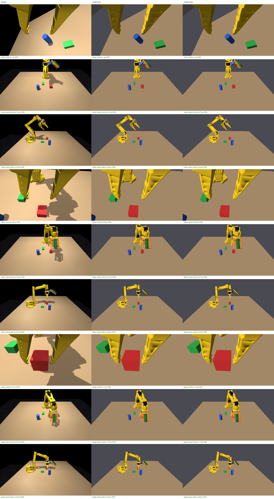

# sim/: SO-101 follower simulation (Newton + MuJoCo Warp)

A simulation of our follower arm, its mounted wrist camera, the workcell and
the fixed cameras. It's built to run on
**[Newton](https://github.com/newton-physics/newton) with `SolverMuJoCo` on the
MuJoCo Warp backend** (GPU). The same model also runs in plain MuJoCo, for
machines Newton doesn't support.

```
sim/
├── config/cameras.toml     # camera intrinsics + poses (wrist pose -> hardware/wrist_mount)
├── config/servos.toml      # HX-30HM limits @ 12 V supply, torque-governor settings, encoder mapping
├── config/safety.toml      # limits of the command filter and the physics monitor
├── config/cables.toml      # the wires: which connector to which, lengths, clips, stiffness guesses
├── scene/workcell.xml      # hand-written: table, objects, lights, physics options
├── scene/bench.xml         # hand-written: the harder scene (drawer, bins, platform, peg and socket) for the bench task
├── tools/build_model.py    # generates model/ from the pristine upstream MJCF + our hardware
├── model/                  # GENERATED (committed): robot + workcell MJCF and meshes
├── so101sim/               # runtime: backends, IK (strict + load-aware), servo model, dynamics, governor
│   ├── bus/                # servo bus at byte level: controller's driver + emulated HX-30HM servos and wire
│   ├── bus_backend.py      # MuJoCo with the servo bus in the loop (teleop.py --bus)
│   ├── camera_fw.py        # the camera firmware built for the PC, fed by the renderer (teleop.py --camera-fw)
│   ├── safety.py           # command filter: the last stage before the servos, in every backend
│   ├── monitor.py          # physics monitor: overlaps, speeds, objects through the table, every step
│   ├── cables.py           # the arm's wires as part of the model (teleop.py --cables)
│   └── tasks.py            # tasks: a description and goals checked against the simulation's state
├── tests/                  # pytest: invariants, fuzzing, config/model/docs consistency (see "Tests")
└── scripts/
    ├── teleop.py           # drive the arm with keyboard + mouse, all three cameras live
    ├── sim_api.py          # REST API: the same controller, driven by a language model or any program
    ├── bench_solution.py   # the bench task done through that API: the proof that it can be done
    ├── pick_demo.py        # scripted pick: end-to-end physics check
    ├── vision_check.py     # every camera sees what it should, per backend
    ├── servo_load_study.py # can the servos carry the wrist camera?
    └── fast_teleop_study.py # torque governor + load-aware IK vs the gentle profile
```

## Run it

| Machine | Backend | Notes |
|---|---|---|
| Linux + NVIDIA GPU | `newton`, solver `warp` (default with CUDA) | The target: MuJoCo Warp |
| Linux, CPU only | `newton`, solver `cpu` | MuJoCo C backend through Newton; same model and cameras |
| Intel Mac | `mujoco` | Warp has no x86_64 macOS build, so Newton can't install. Newton runs in the Lima VM `newton-sim` (CPU) |

```bash
# Linux
python3 -m venv ~/newton-venv && ~/newton-venv/bin/pip install -r sim/requirements.txt
~/newton-venv/bin/python sim/scripts/teleop.py --backend newton          # --solver warp|cpu

# Anywhere MuJoCo runs (Intel Mac: pip install --only-binary :all: mujoco pygame -> MuJoCo 3.10.0)
python sim/scripts/teleop.py                                              # MuJoCo backend
python -m mujoco.viewer --mjcf=sim/model/workcell.xml                     # plain viewer
```

## teleop.py: keyboard + mouse control


The window shows the wrist, scene_front and scene_side cameras plus a status panel:
- target vs actual tip and the fingers' tilt;
- motion mode and tilt cone;
- per joint: position, and predicted torque (% of stall; the red tick is the servo's overload threshold) with
  heat (RMS torque vs the continuous rating).

| Input | Cartesian mode (default) | Joint mode (`J`) |
|---|---|---|
| `W`/`S` or ↑/↓ | tip forward / back (+x/−x) | — |
| `A`/`D` or ←/→ | tip left / right (+y/−y) | move the selected joint |
| `R`/`F`, mouse wheel | tip up / down | wheel moves the selected joint |
| `Q`/`E` | wrist roll | — |
| `1`–`6` | — | select a joint |
| left-click the table in a scene view | move the tip above that point | — |
| `Space` or right-click | open / close the gripper | same |
| `Shift` | fine (×0.2) motion | same |
| `G` | FAST (torque governor, default) / GENTLE (fixed profile) | same |
| `V` | servo feed-forward on (default) / off | same |
| `[` / `]` | tilt cone for load-aware IK, 0–25° (default 0°) | — |
| `H` / `Backspace` / `P` / `F12` / `Esc` | home / reset scene / pause / screenshot / quit | same |
| `X` | **STOP**: drop the move under way and hold the arm where it is | same |
| `T` | torque off (the arm goes limp) / back on, holding where it then lies | same |

- **Always enforced:** joint limits, the camera-safe wrist roll range and a minimum tip height (in joint mode,
  a jog that would take the tip below it is refused).
- **Stall guard:** if an arm joint stays more than 12° behind its command for 0.4 s, something is in the way
  (the table, an object or the arm itself). The goal is pulled back to where the arm is, so the servo doesn't
  sit at full torque. The tip-height limit only covers the tip; this covers everything else.
- **Stop path** (`Teleop.freeze`, `set_torque`, `shutdown`; the switch itself is each backend's
  `torque_off()` / `torque_on()`):
  - **`X` freezes.** The goal becomes the pose the arm is in and the command starts again from there, at
    rest. Torque stays on, so the arm holds and a gripped object stays gripped. Movement keys still held
    down do nothing until they are let go.
  - **`T` switches torque off.** The arm goes limp and sags. While it is off, nothing is commanded: keys
    and clicks are refused, and no goal is written to the bus (on Feetech firmware a goal write switches
    torque back on). `T` again switches it on holding the pose the encoders report at that moment;
    `Backspace` (reset) also switches it on.
  - **Every way out switches torque off:** `Esc`, closing the window, an exception, Ctrl-C and `kill`
    (SIGTERM) all leave through one `finally`. The exit report says whether it was confirmed.
  - **Confirmed, not assumed.** Over the bus the switch is a broadcast, which has no reply. Each servo's
    register is read back, and a servo that missed it is written singly. One that cannot be reached is
    named ("TORQUE OFF NOT CONFIRMED, cut the power"). `enable()` confirms the goals the same way before
    it switches torque on.
  - **What it does not cover:** a dead computer, a dead bus, or `kill -9`. The servos then hold their last
    goal. That takes a switch on the 12 V lead.
- **Modes:** a table click or `H` in joint mode switches to Cartesian mode. Pausing (`P`) freezes the target as
  well as the physics.
- **Motion** (details in [docs/FAST_TELEOP_FINDINGS.md](docs/FAST_TELEOP_FINDINGS.md)):
  - **FAST:** the torque governor commands the fastest smooth motion the 12 V HX-30HMs can follow, staying
    clear of overload protection and heat limits. Keys move the tip at 0.25 m/s.
  - **GENTLE:** the fixed 2.75 rad/s, 8 rad/s² profile, with keys at 0.10 m/s.
  - **Clicks and `H`** travel a straight line, paced by the measured arm. Jumping straight to the far joint
    angles could drive the gripper into the table.
- **IK:** keeps the fingers as close to straight down as the arm allows. With a tilt cone, they may tilt that
  much (above 10 cm only) to lower holding torque. Unreachable targets are refused, with a message.
- **Servo compensation** (`so101sim/command.py`, also used by `pick_demo`):
  - **Feed-forward:** every arm command gets q + (gravity torque + back-EMF × commanded speed) ÷ servo
    stiffness. `V` toggles it, to show the droop it removes (≈5 mm at home).
  - **Grip-by-offset:** when the jaws stall on an object, the gripper holds 3° past contact (≈33 % of stall)
    instead of stalling fully closed into the servo's overload protection. The panel shows "grip HOLD". It
    lets go if the object is lost.
- **Newton on CPU:** add `--render-every 5` (or more), since ray-traced cameras are slow without a GPU.

`--selftest` runs the window headless with scripted keys and mouse events, and checks that:
- `W` moves the tip forward;
- a table click lands within 15 mm;
- the wheel lowers the tip;
- `Space` closes the gripper;
- joint mode moves a joint;
- the load panel reports torque;
- `G` toggles the speed mode;
- `]` widens the tilt cone;
- `H` travels home;
- the cone applies above 10 cm;
- feed-forward removes droop (`V`).

## Servo bus in the loop (`teleop.py --bus`)

For debugging the controller against the hardware's interface before the hardware exists. Instead of
handing joint targets to the physics engine, the controller sends the bytes it would send to the real arm:

```
teleop / pick_demo ── packets ──▶ simulated wire ──▶ 6 emulated HX-30HM ── torque ──▶ MuJoCo
  (BusArm, FeetechBus) ◀─ packets ─                    (registers + control loop) ◀─ angle, speed ─
```

```bash
python sim/scripts/teleop.py --bus                     # same window and keys; a bus report is printed on exit
python sim/scripts/teleop.py --bus --bus-drop 0.05     # lose 5 % of the servos' replies
python sim/scripts/teleop.py --bus --bus-trace 40      # also print the last 40 frames on the wire
```

| Part | File | What it is |
|---|---|---|
| Packets | `so101sim/bus/protocol.py` | Framing, checksum, a stream parser that resynchronises on garbage |
| Driver | `bus/driver.py` | **Controller code.** PING, READ, WRITE, SYNC_READ, SYNC_WRITE over any port; every reply checked; retries; counters |
| Arm | `bus/arm.py` | **Controller code.** Joints in radians ↔ servo ticks. `connect()` only reads and refuses to go on unless the registers look like the HX table; `configure()`; `enable(q)` |
| Register table | `bus/hx_registers.py` | HX-30HM table V3.7, checked against the vendor spreadsheet by a test |
| Servo | `bus/servo_emu.py` | **Our stand-in for the closed servo firmware**: register memory, saved vs volatile registers, lock flag, REG_WRITE/ACTION, the position loop (`servo_model.py`), torque limit, overload protection, feedback registers |
| Wire | `bus/wire.py` | Byte timing at the baud rate, servo response delay, USB latency, reply order of a SYNC_READ, injected faults, a frame trace |
| Backend | `bus_backend.py` | Joins the above to MuJoCo behind the usual backend API |

What it shows that the direct backends can't:

- **Time on the bus.** One encoder read of six servos takes about 4 ms and a full feedback read about 5 ms
  (with the placeholder USB latencies), so a reading is that old when the controller gets it. Teleop uses
  about 15 % of the wire's capacity at 1 Mbaud.
- **What a lost or corrupted packet does** to the control loop (`--bus-drop`, or `drop_command_prob`,
  `corrupt_prob` on `BusBackend`).
- **Set-up mistakes**, reported at connect: six new servos that all answer as id 1, a missing servo, a servo
  at another baud rate, an adapter that echoes, a servo with a different register layout.
- **Register mistakes.** A write to a read-only or undocumented register, or outside a register's range, is
  listed in the report. A test requires that a teleop session produces none.
- **Encoder resolution**: positions are whole ticks (0.088°), in both directions.

Limits, stated plainly:

- The emulated servo is built from Hiwonder's documents and our motor model, not from their firmware. Its
  guesses are listed at the top of `servo_emu.py`; each one is logged when the controller relies on it.
- The numbers in `servos.toml [bus]` (response delay, USB latency, echo) are placeholders until measured.
- MuJoCo backend only. Too slow and too serial for policy training: this is a debugging tool.
- The arm moves the same as with direct joint targets (a test holds the two paths within 0.03 rad during a
  move and a few ticks at rest), because both read the stiffness from `servos.toml`.

Found with it on the first day (DECISIONS X11): with 5 % of packets lost, corrupted and missed, teleop
took a repeated old encoder reading for a blocked arm, reported "blocked" and stopped 20 mm short of the
cube. The stall guard and the lag guard now wait for a new reading.

## Camera firmware in the loop (`teleop.py --camera-fw`)

The wrist camera's picture goes through the **real firmware source** (`firmware/p4-uvc-camera/main/`,
unchanged) built for this PC, with stand-ins for the sensor, the JPEG encoder, FreeRTOS and USB
(`firmware/p4-uvc-camera/host/`, which has its own README). Needs a C compiler; built on first use.

```
MuJoCo render ─▶ sensor stand-in ─▶ firmware (camera task, UVC task, locking, recovery) ─▶ USB stand-in ─▶ PC queue ─▶ teleop
```

```bash
python sim/scripts/teleop.py --camera-fw              # wrist view = 640x480 frames that came through the firmware
python sim/scripts/teleop.py --camera-fw 1920x1080    # full field of view (slower to simulate)
python sim/scripts/teleop.py --bus --camera-fw        # servo bus and camera firmware together
```

The wrist view's label shows the frame rate and how old a frame is when it reaches the PC; a camera report
(counts, the firmware's log, any misuse of the stand-in hardware) is printed on exit. Only the wrist camera
goes through the firmware in teleop, because click-to-move needs the fixed views' full, calibrated picture.

From Python:

```python
from so101sim.camera_fw import UvcCamera, backend_source
cam = UvcCamera(backend_source(sim, "wrist"))     # options={"HFLIP": True, ...}, sensor_stalled=1, ...
sim.step_hooks.append(cam.advance_to)             # same clock as the physics
cam.open(640, 480)
frame = cam.read_latest()                         # .image, .t_exposure, .t_arrival; or cam.read() like cv2
print(cam.report())
```

What it shows:

- **Each size is a crop.** 640×480 is the middle 640×480 pixels of the 1920×1080 picture (a test checks
  this against the renderer), so the "wide" camera is narrow at small sizes.
- **Frame rate is the sensor's 28 fps**, not the 30 the USB descriptor advertises.
- **Delay**, exposure to arrival on the PC: about 24 ms at 640×480 and 46 ms at 1920×1080 with the
  placeholder timings. On top of that comes the PC's queue: a loop that reads slower than the camera with a
  plain `read()` gets frames several periods old; `read_latest()` does not.
- **Start-up**: the first frame arrives about 0.55 s after the PC opens the camera.
- **Shut-down and restart**: 1.5 s after the PC stops reading, the firmware turns the camera off; it comes
  back on the next open, or when frames are requested again.
- **Faults**: no camera on the ribbon cable, a stalled sensor, failed encodes, encoder queue errors,
  misaligned buffers. The firmware's recovery is tested for each, and by seeded fuzzing of PC actions and
  faults in random order.

Found with it (DECISIONS X20, X21):

- During the first 1.5 s after boot the firmware counted frames as "wanted" although nobody had asked for
  one, so a start that failed in that time was retried with no reader. Fixed in `uvc_camera_main.c`.
- One encoder queue error stops the stream for about 1.7 s, because the firmware can only recover by
  restarting the pipeline after 30 bad frames. That is how it was designed; the number is new.

Limits: the pictures are the simulation's, so this says nothing about real image quality, and simulated
frames compress much better than real ones (74 kB at 1080p here), so **USB frame rates for large sizes
are optimistic**. The timings of the stand-ins are placeholders. MuJoCo backend only.

## REST API for a language model (`sim_api.py`)

```bash
python sim/scripts/sim_api.py                       # http://127.0.0.1:8765   (--bus, --camera-fw, --cables as in teleop)
python sim/scripts/sim_api.py --window              # also show the camera views and status panel, actions at real speed
python sim/scripts/sim_api.py --hands-on            # the window also takes teleop's keys and mouse: you and the model share the arm
curl http://127.0.0.1:8765/                         # a guide written for the model: give it this first
curl http://127.0.0.1:8765/state
curl -X POST http://127.0.0.1:8765/move_tip -d '{"x": 0.24, "y": 0.06, "z": 0.09, "square_jaws": true}'
curl http://127.0.0.1:8765/camera/wrist -o wrist.jpg
```

| Endpoint | What it does |
|---|---|
| `GET /` | A plain-text guide for the model, worded for how this server was started: units, frame, what "tip" means, how time works, this scene's objects and their sizes, where the cameras stand, what each message means, a pick step by step, every endpoint and parameter with its range |
| `GET /openapi.json` | The same endpoints as OpenAPI 3, for tools that build function definitions from it |
| `GET /state` | Time, joint angles and limits, tip, wrist roll, gripper (opening, gap, holding), servo loads, the controller's last message, physics and filter checks, and the objects' positions |
| `GET /cameras`, `GET /camera/{name}` | The cameras; a camera's picture as a JPEG (`?base64=true` for JSON) |
| `POST /randomize` | Reset, then put every loose object somewhere new: upright, turned at random, within reach, clear of everything else (`seed` to repeat a layout) |
| `POST /move_tip` | Straight-line move of the tip to x, y, z (optional `roll`, `square_jaws`, `jaws_along_deg`) |
| `POST /move_joints` | Joint angles in radians |
| `POST /gripper` | `opening` 0 to 1, or `gap_m` between the pads; closing on something holds it gently |
| `GET /task` | What is to be done in this scene (`--scene bench`), and which of its goals hold now |
| `POST /wait`, `POST /reset`, `GET /report` | Let time pass; start again; the monitor's, filter's and optional layers' reports |

How it is meant to be used:

- **Turn-based.** Simulated time moves only inside an action, which runs until it is finished or its
  timeout passes and then answers with `reached`, `elapsed_s`, `tip_error_m`, the controller's message
  and the state afterwards. Reading is free. So the model can take as long as it likes to think, and
  the same requests always give the same run.
- **The same controller as teleop**, behind the same command filter and physics monitor. The model can do
  what a person at the keyboard can, and no more.
- **Errors are sentences.** A request that cannot be done answers `ok: false` with the reason and the
  allowed range, and changes nothing. Unknown fields are refused by name (a misspelt parameter is not
  silently ignored).
- **"Tip" means the point midway between the jaw pads**, not the controller's own tip (which sits on the
  fixed jaw's pad): put the tip on an object's centre and the object is between the jaws.
- `/state` includes the objects' true positions, which a real robot would not have.
  `--no-object-positions` leaves them out, and the model has to use the cameras.
- `--hands-on` makes the window teleop between requests (same keys, mouse and controller), with the
  simulation running at real speed. While a request's action runs the keys are ignored; the action starts
  from wherever you left the arm. Time then also passes between requests, so a run is no longer repeatable.
- **Working from pictures only:** start with `--no-object-positions`, `POST /randomize`, then use `/camera`.
  The API gives no camera calibration (a `/pixel` endpoint that turned a pixel into a line of sight was tried on
  2026-11-12 and removed the same day, DECISIONS R11): the caller has to work out where things are itself.
- It listens on this machine only (`--host` changes that), has no authentication, and serves one request
  at a time.

## The bench scene and task (`--scene bench`)

A harder scene for the same arm, with a task whose goals the simulation checks.

```bash
python sim/scripts/sim_api.py --scene bench --window     # one terminal: the scene, the API, a window to watch
python sim/scripts/bench_solution.py                     # another: tidies the bench through the API (about a minute)
curl http://127.0.0.1:8765/task                          # the task in words, and which goals hold now
python sim/scripts/teleop.py --scene bench               # or try it by hand
```

| In the scene | |
|---|---|
| Cabinet with a drawer | The drawer slides 85 mm toward the robot on a joint with friction; its handle is a 12 mm post on its front panel |
| Red bin, blue bin | Four 14 mm walls each, 56 mm square inside |
| Platform | 80 mm square, 40 mm high |
| Socket | A block with a 26 mm square hole, 25 mm deep |
| Loose parts | Red cube (starts in the closed drawer), purple cube (starts on the cabinet's roof), blue cylinder, yellow peg (18 mm across, 60 mm long), green block |

The task, all at once: red cube in the red bin; blue cylinder upright in the blue bin; peg standing in
the socket; green block flat on the platform with the purple cube on it; drawer closed; nothing held or
moving. The red cube cannot be reached until the drawer is opened, and the purple cube cannot be placed
until the block is.

**It can be done:** `bench_solution.py` does it through the REST API alone in 62 s of simulated time, with
the physics monitor clean, and a test runs it. It is a closed loop: before each step it reads where the
part is, which way the jaws ended up and how high the arm reaches there.

What building it taught, all now in the scene's layout or the API:

- **Reach.** With the fingers straight down the arm reaches 12 cm or higher only between 0.20 and 0.32 m
  from its base (closer in, the limit falls to 10 cm at 0.18 m and 5 cm at 0.12 m). Everything that has to
  be approached from above is inside that band.
- **Which way the jaws close matters.** Pinched across its 25 mm width, the 20 mm-high block rolled onto
  its side; across its 40 mm length it does not. Closing along x at the drawer handle, one jaw came down on
  the cabinet's roof. `/move_tip` takes `jaws_along_deg` for this, and `/state` reports the direction.
- **A tip at the table cannot close.** The moving jaw swings a little lower as it closes, and the command
  filter will not send any part of the arm below the table top, so low parts are held from 10 mm up.

A scene is a file in `sim/scene/`; a task is a class in `so101sim/tasks.py` with a description and goals.

## The whole system: a world, the hub on its ports, two APIs (`scripts/run_system.py`)

```bash
python sim/scripts/run_system.py --scene open_small
curl http://127.0.0.1:8765/      # the hub's API, for the model (hub/README.md)
curl http://127.0.0.1:8766/      # the operator's API: scenes, ground truth, scoring. Never for the model
```

- **The world** (`so101sim/world.py`) runs the loaded scene and offers ports: a serial port per servo bus
  (emulated HX-30HMs on a simulated wire), a camera port per camera (a full-size picture through that
  camera's lens and JPEG, costing a frame period plus the transfer on the clock), and the clock.
- **The hub** ([hub/README.md](../hub/README.md)) is started on those ports and given nothing else. It finds
  the devices, takes the arm over, works out which camera is on the wrist, and serves the model's API.
- An arm's servos were left powered and holding its starting pose, so an arm no hub has connected to stays put.
- **A rover's servos are on a bus of their own, behind a radio link** (`RadioPort`): every byte is a few
  milliseconds late each way, now and then much later, and nothing passes while the link is down. The
  rover's own board stops its wheels after 0.4 s without a word from the hub. Its cameras come over the
  same link, more slowly than USB.
- **The rover's battery** drains by what the servos and boards draw; its servos see and report the voltage.
  A scene sets how full it starts (`battery_charge`, default 0.9).
- **The servo emulator has motor mode** (operating mode 1): a speed loop on register 46, bit 15 the direction;
  the position then reads within one turn. The loop's gains are a guess at the firmware's.
- Loading another scene over the operator API is, to the hub, everything going quiet (its requests answer
  503 "did not answer"); `POST /discover` on the hub finds what is there now.
- `scripts/sim_api.py` is the older single-arm API. Its arm actions are now the hub's (it inherits them), and
  it will go once the bench task's solution runs through the hub.

## Tasks done through the hub's API (`scripts/solve.py`, `scripts/model_run.py`, `solutions/`)

```
python sim/scripts/solve.py --list                 # which tasks have a reference solution, and why the others do not
python sim/scripts/solve.py                        # run every solution; the referee scores each
python sim/scripts/solve.py workcell stack
python sim/scripts/model_run.py shelf on_the_shelf # give the task to a language model instead (billed to your account)
```

**Reference solutions** (`sim/solutions/`). Each is handed the hub's API and nothing else: no scene file, no
simulation, no referee. What a model would do by looking, a solution does with colour thresholding on the
pictures (`eyes.py`); where things are comes from the hub. `solve.py` plays the operator: it hands in the
solution's answers and asks the referee whether the task's goals hold.

| Scene / task | Result | How |
|---|---|---|
| `open_small`, `moved_arm`, `l_shaped` / `where_is_everyone` | done, 1 to 3 mm off | The arm shows its wrist tag; the camera's focal length is found; `GET /where` |
| `no_arm` / `where_is_everyone` | done, 4 mm off | The camera sees the rover's tags |
| `no_arm` / `how_big` | done, 7 % over | Survey; the surface's raised edges in the map are two pairs of parallel lines |
| `shelf` / `on_the_shelf` | done: red, 0.080 m | Survey; the coloured thing whose lowest seen part is well above the surface stands on the shelf, and that lowest part is the shelf's top |
| `shelf` / `under_the_ledge` | done: green | Survey; a coloured thing lower than a raised flat thing's underside and within its outline lies under it (the rover's low pass looked under) |
| `moved_arm` / `carried` | done, 1 mm off | Asks every device for something fresh after the swap; a 503 says they were moved; discover, locate again |
| `workcell` / `stack` | done | A fixed camera finds each colour roughly (`GET /where/pixel`); the hand hovers and the wrist camera looks down; a touch gives the height; a second look gives the place to a few millimetres; pick, carry, set down |
| `moved_arm` / `fetch` | done | The same, into the tray: a pale frame with the surface showing through it (a printed tag is pale too, with black inside) |
| `shelf` / `fetch_from_shelf` | done | The same, with the cube 80 mm up on the shelf: the touch starts higher and finds its top |
| `cluttered` / `tidy_by_colour` | done, all four | Each colour's bin is the frame of that colour; each thing of that colour is carried to it and set down beside the last, not on it |
| `cluttered` / `fetch_hidden` | done, upright | The same, for the yellow peg. The arm is printed yellow too: a patch the wrist camera, hovering over it, does not find (or that the hand cannot hover over) is passed over and the next one tried |
| `l_shaped` / `far_leg` | done: 3 (green, purple, yellow) | The rover cannot drive there: it is too wide to turn in a 0.4 m leg, and a cube stands in front of it. It need not. It turns its head each way; each patch of colour in its picture is put on the surface where its foot is (`GET /where/pixel`); a place outside the fixed camera's picture (`GET /where/point`) is out of its sight. What is in line with the arm, at it or past it, is left out: the arm is printed yellow |
| `open_small` / `how_big` | gives up | The far edge is behind the arm. The rover turns to face where an edge is missing, drives as far as the map lets it and looks again, twice; it still cannot see all four. It says so and hands in nothing |
| `l_shaped` / `how_big` | gives up | 0.55 m2 of the surface has been seen and the edges found enclose 0.32: not a plain rectangle. The ends of both legs are beyond what the rover sees from the one place it can stand. It says so and hands in nothing |
| the other two | none | `solve.py --list` gives the reason for each: `drawer_open` takes judging a picture; the bench's `tidy` still runs on the old API |

Before each look from a fixed camera the arm goes back to how it stood at the start: a hand hovering over the
surface hides what is under it (found when the cube on the shelf vanished behind the hand that had just looked
at the tray).

**Model runs** (`model_run.py`). The same arrangement with a language model in place of the solution: it gets
the task's request, the hub's guide and three tools (read from the API, send a command, say it has finished),
and pictures come back to it as pictures. It needs `pip install anthropic` and credentials, and every run is
billed. *It has not been run:* no run was made while writing it.

## The rover board's firmware in the loop (`run_system.py --rover-fw`)

`firmware/rover-bridge/main/bridge.c` is the rover board's own logic: it passes the servo bus's bytes between
the hub's link and the servos, and stops the wheels when the hub has said nothing for 0.4 s. It is plain C, and
`so101sim/rover_fw.py` compiles it for this PC (warnings as errors, cached in `sim/.cache/rover_bridge/`).
`World(scene, rover_firmware=True)` runs it between the simulated radio link and the emulated servos, in place
of the simulation's own model of that board; the two are tested to behave alike. The part that needs the board
(Wi-Fi, the socket, the UART) is written and has not been built: `firmware/rover-bridge/README.md`.

## Scenes as files (`sim/scenes/*.toml`)

A scene is a config file: the surface's outline and lip, fixtures, loose objects, where each device was
put down, and tasks. It is built into a MuJoCo model in memory, so a scene can be loaded, changed and
loaded again while the program runs. Part of the multi-device work: [docs/MULTI_DEVICE_PLAN.md](../docs/MULTI_DEVICE_PLAN.md), 5.7.

```python
from so101sim import scenes
scenes.names()                         # ['open_small', 'workcell', ...]
scene = scenes.read("open_small")      # a dict, as the file has it
scenes.validate(scene)                 # [] if it is a place that can exist; else sentences saying what is wrong
built = scenes.build(scene)            # built.model, plus what the referee needs (objects, regions, devices)
```

| Part of the file | What it says |
|---|---|
| `[surface]` | `outline_m`: corners of the surface, right-angled, any shape made of rectangles. `lip_height_m`: every scene has a lip. Friction, colour |
| `[[fixtures]]` | Things fixed to the surface: `box`, `bin`, `socket`, `cabinet` (with a sliding drawer), `shelf`, or free `parts` |
| `[[objects]]` | Loose things: `box` or `cylinder`, size, mass, colour, `at_m` or `on = "<fixture>"` |
| `[[devices]]` | Where each device was put down: `arm`, `camera`, `rover`. Ground truth: the hub is never told |
| `[[regions]]` | Named places for task goals (bins, drawers and tops of fixtures are regions already) |
| `[[tasks]]` | A request in words, and goals the referee checks (`so101sim/scenes/tasks.py`) |

- **Valid** means: the fields are right; the model compiles; everything is inside the lip; nothing
  overlaps; nothing moves when the scene is left alone for a second; every task names things that exist,
  starts not done, and has goals that could hold. Checked without running any device.
- **`workcell.toml`** is the original workcell in this form: the same model as `sim/model/workcell.xml`
  plus the lip and a housing and post for each fixed camera (a test compares them).
- **The rover in a scene is a placeholder box** until it is designed (`so101sim/rover_model.py`).
- The old path (`load_backend`, `--scene`, `sim/scene/*.xml`) is unchanged and does not read these files yet.

The scenes so far, each with its tasks:

| Scene | What it is | Tasks |
|---|---|---|
| `workcell` | The original table and three objects | `stack` |
| `bench` | Cabinet with drawer, bins, platform, socket, five parts, the rover | `tidy` (the old bench task), `drawer_open` |
| `open_small` | A small bare surface: arm, camera, rover, two objects | `where_is_everyone`, `how_big` |
| `l_shaped` | An L; the camera sees one leg, the arm reaches neither end | `far_leg`, `where_is_everyone`, `how_big` |
| `shelf` | A shelf on legs and an overhanging ledge | `fetch_from_shelf`, `on_the_shelf`, `under_the_ledge` |
| `cluttered` | Things that hide each other, lit from one side | `tidy_by_colour`, `fetch_hidden` |
| `no_arm` | Rover and two cameras | `where_is_everyone`, `how_big` |
| `moved_arm` | The arm at a corner, turned 225° | `where_is_everyone`, `fetch`, `carried` (the scene is swapped mid-run) |

A task is a request in words plus goals. Arrangement goals (`inside`, `on`, `upright`, `fixture_at`) are
checked on the true state; answer goals (`answer_number`, `answer_text`, `answer_list`, `answer_pose`) are
checked on what was handed in, against a truth worked out from the scene. Created and validated only:
that each can be done waits for the system that does them.

### The operator's REST API (`scripts/operator_api.py`)

```bash
python sim/scripts/operator_api.py                 # http://127.0.0.1:8766, scene open_small loaded
curl http://127.0.0.1:8766/                        # the guide
curl -X PATCH http://127.0.0.1:8766/scenes/shelf -d '{"objects": {"red_cube": {"at_m": [0.5, 0.2]}}}'
curl -X POST http://127.0.0.1:8766/world/load -d '{"scene": "shelf"}'
curl http://127.0.0.1:8766/world/truth
```

For people, tests and scripts. It holds ground truth, so it is on its own address and the model driving
the hub is never given it.

| Endpoint | What it does |
|---|---|
| `GET /scenes`, `GET /scenes/{name}` | The scene files; one scene as JSON |
| `PUT /scenes/{name}` | Create or replace. Checked first; an invalid scene is refused with every problem listed, and nothing is saved |
| `PATCH /scenes/{name}` | Change part. Tables merge; items of `fixtures`, `objects`, `devices`, `regions`, `tasks` are addressed by name; `null` removes |
| `DELETE /scenes/{name}` | Refused for the scene that is loaded |
| `POST /scenes/{name}/validate` | Check without saving or loading |
| `GET /world`, `POST /world/load`, `/world/reset`, `/world/step` | What is running; swap scenes while it runs; start again; let time pass |
| `GET /world/truth` | The referee: where everything really is |
| `GET /world/tasks`, `GET /world/tasks/{name}` | Tasks; a task's goals and whether each holds |
| `POST /world/tasks/{name}/answer` | Hand in an answer. The reply does not say whether it is right |

- Changing the loaded scene reloads it: `generation` goes up and time restarts.
- An edit over the API rewrites the file and drops its comments.
- `so101sim/world.py` is the running scene. Until the hub exists no device is driven in it: the arm holds
  its starting pose and the rover stands still.

## Printed tags on the arm

The arm carries nine AprilTag 36h11 tags so that other devices' cameras can find it: two 38 mm tag blocks
beside its base (a 30 mm tag on the top, front, back and outer face of each) and a 24 mm tag on a cover
plate behind the wrist camera. Their places are written once, in [hardware/tags/layout.toml](../hardware/tags/layout.toml);
`tools/build_model.py` puts them in the arm's model (step 4c) and the hub reads the same file.

- The blocks and the plate have collision shapes, so the command filter's base keep-out includes the blocks.
- Reading them is the hub's job: [hub/README.md](../hub/README.md).
- `World.render(camera, width, height)` gives a full-size still; 640x360 is too small for locating.

## The lens: pictures are not perfect (`so101sim/lens.py`)

MuJoCo draws an ideal pinhole picture. `World.render(camera, width, height)` passes it through that
camera's own lens and sensor first:

| Effect | How | Placeholder value |
|---|---|---|
| Distortion | The scene is rendered wider and larger than needed, then warped by OpenCV's lens model about the camera's true focal lengths and centre | k1 = −0.033, from the datasheet's 102° field where a pinhole gives 99° |
| Darkening toward the corners | A gain that falls with distance from the centre | 35 % at the corner |
| Blur | Gaussian, more off-centre | sigma 0.6 px at the centre, 1.4 px at the corner (at 1080p) |
| Noise | Read noise plus shot noise, different in every frame | 1.5 grey levels + 0.25 × √level |

- **Every camera has its own lens** (`lens_for(name, seed)`): focal length within about 1 %, centre within
  about 6 px, distortion a little different. The seed is the scene's `[imperfections] seed`.
- **The hub is never given these numbers.** It has the camera kind's nominal values (`hub/builtin.py`).
- `render(..., ideal=True)` gives the pinhole picture, for checks that are not about the lens.
- A full-size picture takes about 0.3 s (2.4 s the first time a size is used).
- All values are placeholders until one of the real cameras is calibrated. JPEG is left to the camera port.

## Physical invariants: nothing clips, nothing jumps

Enforced in layers, because each one fails differently (limits in `config/safety.toml`):

| Layer | What it guarantees | Where |
|---|---|---|
| **Model** | Every solid part has a collision shape that is where the part is (convex decompositions, not one hull per part; the base included). The table is solid to the floor. Contacts are stiff (`solref 0.004`): at full servo torque the arm sinks 1.3 mm on impact and 0.04 mm at rest, where it used to sink 10 mm | `tools/build_model.py`, `scene/workcell.xml` |
| **Command filter** | Whatever produced a joint command, the servos only get one that is finite, inside the joint limits, not a jump, and not for a pose under the table or inside the base | `so101sim/safety.py`, in every backend's `set_targets()` / `step()` |
| **Physics monitor** | Every step: no overlap deeper than 5 mm (or 1.5 mm for more than 50 ms), no joint faster than its servo can turn, no acceleration a motor could not produce, no object faster than 3 m/s or below the table top, no non-finite state | `so101sim/monitor.py`; on in teleop, `pick_demo` and every teleop test |
| **Tests** | The above as properties: fuzzed command streams, a cube thrown at 2 to 40 m/s, the arm at full torque into the table, contacts compared with the real meshes | `tests/test_invariants.py` |

The command filter, precisely:

- **A jump** is one tick's change larger than a servo could follow (1.3 × no-load speed). It is not passed
  on; the filter goes there in a straight line in joint space at the torque governor's own speed and
  acceleration caps, and keeps following the request meanwhile. A smooth stream passes through bit for bit.
- **Keep-outs** are checked on the pose the controller *intends*, not on the command. Feed-forward shifts
  a command up to about 11° ahead of the arm, so a command can point under the table while the arm is
  nowhere near it. `set_targets(q, intended=...)` carries the uncompensated pose; teleop and `pick_demo`
  pass it. A step that would enter a keep-out is cut to the part that stays out.
- **It is a backstop, not a planner.** A command's own speed and acceleration are not limited: ordinary
  teleop commands show 1400 rad/s² tick to tick, because the command is not the motion. Smooth motion is
  the governor's job (teleop) or a profile's (`pick_demo` now uses the speed-and-acceleration profile;
  it used a speed limit only).
- Teleop says so on screen when the filter steps in, and prints a summary on exit.

Found by the filter on its first day: in a fast descent started by one large jump of the target, the
joints race each other and the planned path takes the fixed jaw's tip about 3 mm under the table top
before it settles. The servos' softness had hidden it. The filter now cuts that short; clicks and the
wheel were already straight-line moves.

## Wires (`teleop.py --cables`)

Every wire of the workcell as part of the model: the servo bus leads, the camera ribbons, the USB cables,
the supply lead. A second model file (`model/workcell_cables.xml`), because the wires make a step about
twelve times as expensive. It also gives each fixed camera a placeholder body (the wrist's holder and
board on a plain post), since a cable needs something to hang from and their stand is not designed.

```bash
python sim/scripts/teleop.py --cables                    # with the wires; a wire report is printed on exit
python sim/scripts/teleop.py --cables --bus --camera-fw  # everything at once
```
```python
sim = load_backend("mujoco", cables=True)
print(sim.cables.report(sim.d))        # per wire: length, how far apart its ends are, how hard it is pulled
```

Each wire is a chain of 20 to 25 mm capsules joined by ball joints with a spring (bending stiffness) and
damping; a ribbon is a chain of flat strips joined by hinges, so it folds about one axis only. Its first segment is fixed in its connector, pointing the way the connector does; its far end
is held in the other connector (or a clip) by a ball constraint. So a wire has its real length: it hangs
slack, follows the arm, lies on the table, pulls on the joints, and goes taut if it is too short. At a
reset the wires are laid along a smooth slack curve for the arm's pose and left to settle for 0.4 s with
the arm and the clock held still.

| Wire | From → to | Length | Touches the arm? |
|---|---|---:|---|
| `bus_board_pan` | driver board → pan servo | 200 mm | no |
| `bus_pan_lift` | pan servo → lift servo | 200 mm | no |
| `bus_lift_elbow` | lift servo → elbow servo | 200 mm | yes |
| `bus_elbow_wrist` | elbow servo → wrist-flex servo | 200 mm | yes |
| `bus_wrist_roll` | wrist-flex servo → wrist-roll servo | 200 mm | no |
| `bus_roll_grip` | wrist-roll servo → gripper servo | 200 mm | no |
| `usb` | wrist camera board → forearm clip → upper-arm clip → table | 260 + 160 + 340 mm | yes |
| `ribbon_wrist` | wrist camera → its board (on the holder) | 150 mm | no |
| `supply` | driver board → back edge of the table | 200 mm | no |
| `bus_usb` | driver board → back edge of the table | 200 mm | no |
| `ribbon_scene_front`, `ribbon_scene_side` | fixed camera → its board | 150 mm | no |
| `usb_scene_front`, `usb_scene_side` | fixed camera board → top of its post → clip 15 cm down | 70 + 180 mm | no |

What it has already told us:

- **The 20 cm servo leads reach everywhere.** Over the whole joint range no two consecutive sockets are
  more than 135 mm apart.
- **The USB cable's first stretch must be about 260 mm, not 200.** Its ends are never more than 162 mm
  apart, but at some wrist poses it wraps around the wrist link; at 200 mm it was pulled taut there
  (3.7 N, pressed 3 mm into the link). A straight-line reach check misses this.
- **The wires cost the servos almost nothing** as long as they are slack: under 5 % of stall torque, and
  the arm ends within 0.03 rad of where it goes without them.
- **A fixed camera's USB cable must be tied down right behind the camera.** It leaves the board upward;
  left free, it flopped forward within a few seconds and hung straight down across the lens.
- **The wrist ribbon's spare length hangs to 13 mm above the table at a grasp** if it is not folded away
  (150 mm of ribbon for a 49 mm run).
- **The USB cable needs about 0.76 m on the arm** before it reaches the table. The spliced camera lead in
  the parts list is about 0.45 m, so its join to the extension would hang on the upper arm (`docs/BOM.md`).

Limits, stated plainly:

- Known: which connector goes to which, the leads' length, where the servo sockets are (from the mesh).
  Chosen here: where the USB cables are clipped. **Guessed:** every wire's weight and bending stiffness, and
  where the connectors are on the camera boards and the driver board. `config/cables.toml` marks each and gives a
  sag test to measure stiffness.
- Four of the leads run inside or against the brackets. Their path through the hollow parts is not
  modelled, so they pass through the arm's plastic (they still lie on the table and touch the objects).
  Letting them collide with the arm jammed the pan joint: a wire laid out through solid plastic.
- Wires do not collide with each other, and a ribbon or cable does not collide with the holder it is on.
- The fixed cameras' holder, board and post are placeholders, there only in the cabled model. Their
  cables stop at a clip on the post; the run from there to the PC, and the supply lead beyond the
  table's edge, are not modelled.
- A ribbon is modelled 1 mm thick (a real one is 0.1 mm, too thin to collide).
- MuJoCo backend only; about 1.2 ms per step instead of 0.1 ms.

## Tests

```bash
pytest sim/tests        # ~3 min on a laptop CPU; MuJoCo backend, plus Newton where it is installed
```

The tests go after classes of bugs, not single cases:

| File | What it guards |
|---|---|
| `tests/harness.py` | The invariant monitor every teleop scenario runs under: no servo at its torque limit or above its overload threshold for more than 1 s, nothing commanded outside the joint limits, the tip never under the table. Also the headless teleop rig |
| `test_command.py` | Grip-by-offset on a simple jaw model for every command shape (step, fast ramp, slow ramp, 30 Hz stream) and update rate: latches on contact, holds at the designed squeeze, never latches on air, releases when the object is lost or on opening. Feed-forward stays bounded for any command |
| `test_governor.py` | Seeded fuzzing of full-range joint jumps with three payloads: arrives, stays inside the limits, doesn't run past the goal. The lag guard gives the same result however often the arm is measured |
| `test_teleop.py` | Headless teleop: grasp, lift and release the cube in FAST and GENTLE; the load panel against the torque the simulated servo delivers; joint-mode clicks and jogs; pause; bad targets; the roll range; clicks across the workspace |
| `test_consistency.py` | Numbers that live in two places: config vs the generated model (and the model is what the generator writes now), runtime vs config, the wrist-roll range vs what the collision study sampled, contact pairs for the wrist mount, docs vs data, imports vs `requirements.txt` |
| `test_cli.py` | Every script answers `--help` and rejects bad arguments without a traceback or starting work; `pick_demo` (watched for gripper overload), `vision_check` and the teleop self-test |
| `test_backend_contract.py` | The same API behaviour on MuJoCo and Newton: timestep, reset, targets, objects on the table |
| `test_tasks.py` | Scenes and tasks: every scene has its generated models and sits still from the start; the bench task starts undone and is done by the reference solution through the API with the monitor clean; undoing any one goal makes it false again; every place the task's description names is where the model has it |
| `test_api.py` | The REST API: a whole pick through requests alone; reading costs no simulated time and actions do; the same requests give the same run; every request that cannot be done says why and changes nothing; fuzzed methods, paths and bodies never crash the server or disturb the simulation; the guide and OpenAPI document cover every endpoint and parameter; a round trip over a real socket |
| `test_invariants.py` | Collision shapes are where the parts are: wrist roll is free and costs the same torque over its whole range; contacts are reported only where the real meshes are within 3 mm; the base is solid and stands on the table. Nothing sinks into or passes through the table (arm at full torque, a pressed cube, a cube thrown at 2 to 40 m/s). The command filter: no fuzzed request stream (jumps, NaN, out of range) gets an unsendable command through or a pose into a keep-out; a smooth stream passes unchanged; every backend sends its commands through it; ordinary teleop leaves it idle. The monitor catches each kind of violation when one is provoked |
| `test_cables.py` | Every wire is long enough over the whole joint range. The slack layout meets both ends for fuzzed inputs. At a reset, for any arm pose, the wires reach their sockets, come to rest, stay above the table and leave the arm and the clock alone. Moving through random poses with wires: monitor clean, no wire pulled hard, the arm ends where it does without wires. The cabled model is the plain robot plus wires |
| `test_camera_fw.py` | The camera firmware in the loop (skipped without a C compiler). Every frame that reaches the PC is the frame the sensor took, at every size. Frame rate and delay are what the sensor, encoder and link allow; a slow link lowers the rate and corrupts nothing. Close, reopen, resume, suspend and size changes shut down and restart cleanly with nothing leaked. No camera, stalled sensor, failed encodes, encoder queue errors, misaligned buffers. Seeded fuzzing of PC actions and faults: never stuck, never leaking, never misusing a device. Each build option does what it says (flips keep colours, fixed exposure holds, JPEG quality). The stand-in hardware really reports misuse. The same run gives the same result. A smaller size is the centre of the larger picture. Teleop shows the firmware's frames |
| `test_stop.py` | The stop path, on direct joint targets, a clean bus and a faulty one. A stop from any motion (click, keys, joint jog, home) leaves the arm at rest where it was, even with the keys still held, and keeps a gripped cube gripped. With torque off no servo delivers any torque and nothing a person presses gets through. Torque on holds the arm where it lies. A broadcast a servo missed is noticed and repaired, or the servo is named; no goal is written while torque is off. The real program leaves torque off on Esc, an exception, Ctrl-C and SIGTERM |
| `test_scenes.py` | Scenes as files. Every scene in `sim/scenes/` is valid and survives being written and read back. The lip has no gap for any outline. `workcell.toml` is today's model plus the lip. Random right-angled outlines are tiled exactly. Seventeen kinds of fault (unknown field, a thing past the lip, an overlap, a thing in mid-air, a task about nothing, a task already done, a thing too big for its place, ...) are each named by the validator. An invalid scene is not saved |
| `test_operator_api.py` | The operator's API. Scenes are listed and read back as they are; a patch changes only what it names; changing the loaded scene restarts the world. Twenty-four kinds of refused request each say why and change no file and nothing in the world. Fuzzed methods, paths and bodies never get a server error and never leave an invalid scene on disk. Loading another scene leaves nothing of the old one. Every arrangement goal of the bench task follows the things themselves; answers are scored against the truth and the caller is not told; a pose answer is scored in the named device's own frame; a task that swaps scenes is scored in the scene swapped to |
| `test_markers.py` | Printed tags. The simulated tag is the printed file and the family's bits. The hub's belief about each tag (place, facing, which edge is up, size) is what the model has, and every tag lies flat on a face of the part that carries it. Each tag alone, seen from in front, gives the right pose with orientation. A mirrored or turned tag never yields a trusted wrong fix. Cameras in every scene, and at twelve seeded places no file knows, are located from the picture alone within the stated error, and the stated uncertainty covers the true error. Moving a camera 3 cm moves the estimate 3 cm. A flat reading is flagged, not believed. The hub imports nothing from the simulation |
| `test_lens.py` | The lens model. Dots at known points come out where OpenCV's own projection puts them with the camera's true values (to 0.35 px). A straight line comes out bowed outward, evenly; the ideal lens leaves it straight. Corners are darker and the middle is not. Noise differs frame to frame and leaves the level alone. Every camera has its own lens, the same every time, and none is the nominal one. Cameras are still located through the lens within what is stated, with honest uncertainty |
| `test_hub.py` | The hub, started from ports alone. It imports nothing from the simulation and can reach the world only through a port object. No name from the scene file is in any answer; changing what no sensor can tell (masses, friction, the scene's description) changes no answer. In every scene it finds the right devices and picks out the wrist camera; in five scenes, one with the arm turned 225°, a pick through its API lifts the object. `/where` gives an estimate with honest uncertainty or says it cannot tell, and follows a camera moved 3 cm. Stop and torque through the tree. Seventeen kinds of refused request say why and move nothing; fuzzed requests never get a traceback. Devices that vanish when the scene is swapped are said to have vanished and are found again on discover |
| `test_locator.py` | The locator. Links chain and invert like poses, and a chain's stated uncertainty is what sampling gives. The hub's idea of where the arm's tags and wrist camera are matches the referee at any joint angles, with the arm neither at the origin nor facing +x. In every scene each camera is located within 3.5 times its stated uncertainty or said not to be; answers read the same from the other end; the wrist camera is placed in a fixed camera's frame through the arm; two cameras are related through the arm they both saw. A camera that cannot see the base is found by the wrist tag. Eight seeded camera places with their own lenses. Not known without an arm, or from one flat tag seen once. Age counts from the newest sighting. A camera moved behind the hub's back is noticed and followed |
| `test_rover_model.py` | The rover's CAD and the simulated rover made from it. Every printed part is one solid with its files; no two parts meet anywhere in the axes' travel; leads are long enough; the weight sits between the wheels and the caster. The simulated rover weighs what the CAD says, has its tags where the hub believes, and its lenses where the CAD puts them. It stands level, rolls as far as its wheels turn and straight, turns on the spot by what its wheels say, and is held by the lip. Every head axis reaches its range with nothing touching, the head level and the cameras even |
| `test_rover.py` | The rover under control. Motor mode holds a speed under load and reads its position within one turn. A slow link is not a dead one. The rover's board stops the wheels when the hub goes quiet; a link cut mid-drive is said so and recovered from. The battery: cells, what the servos see, nothing moves when low. The hub's idea of the rover's cameras, tags and lowest point matches the referee at random head poses. Drives and turns do what is asked and are counted (0.40 m is two turns of a wheel); a square comes back. No driving with the head up; the head is never sent into the ground; stow from anywhere; a jammed joint stops pushing. Stop and shutdown. Its place in the tree |
| `test_survey.py` | The start-up survey. Depth from perfect pictures is the true depth in each of the survey's passes, nearer than the fine search reaches included; two different lenses have their rows lined up from the pictures; triangulation, the tag ruler and the ground plane on made-up data. The place: empty until something is seen; a made-up surface, box and raised edge are found where they were put at six random turns and shifts of the map; points scattered below the surface are not believed; which ways nothing has looked. The rover in the locator: cameras that see its tags place it within what they state in four scenes, the same from the other end; two cameras related through it; its own cameras where the head puts them; a sighting carried forward by the wheels grows less sure and stays right; forgotten when told. Whole surveys (`no_arm` on request, `bench` at start-up): nothing known before; only the head moves and is put back; seen-free cells lie on the true surface; every loose thing in range is in the map with its height; long edges lie on the true outline with the surface inside; the rulers; the arm related to the rover; the API names nothing from the scene; no rover or a low battery, no survey. A head that meets a post stops without spinning the rover; a survey beside a post says so and does not trust a map made while turning; a turned view is measured |
| `test_map.py` | The map from every device. A colour gets the word a person would use; a thing has the colour of its own points. The map re-expressed in another frame is the map that would have been made there, at six random turns and shifts. Landmarks: things found twice relate the two frames within what is stated (eight seeded layouts, with things never touched and a touch of bare surface among them); two things alike are refused until a third settles it; touches that do not match relate nothing; a rover placed by landmarks is carried by its wheels. The arm's touch reads each thing's height within 8 mm and leaves it where it was; bare surface reads as nothing there; touches are kept; a touch that cannot be made moves nothing. One more view: refused with the head stowed; a cube seen from where the rover has driven to lands on the same cube. On the bench after a start-up survey: things in the arm's frame are where the referee has them, long edges on the true outline, the arm's own parts marked as the arm; each thing is where the map says in each camera's picture; the map is not given in a frame nothing relates it to. With no camera and no tags in sight, two touches relate the arm to the rover |
| `test_safety.py` | Safety from what has been found. Stop at the root freezes every device and the way out leaves all twelve servos unpowered; stop under one device leaves the other. The rover: with nothing looked at it only crawls; after a survey it does not drive or turn into the cube the map has, and names it where it is; backing into never-seen space is slow, the edge stops it, what the wheels counted while slipping is taken back and what stopped it is in the map; where it stands is free. Thirty fuzzed drives (two seeds) move nothing, never leave the surface and stay counted. On made-up maps a drive is cut short of an occupied cell whichever way it goes. The arm: a path through a block put into the map is refused naming it where it is, over it is allowed, ending at it or leaving it is careful; the hand is kept out of where the rover is, by move and by touch; forty fuzzed tip targets (two seeds) never touch the rover and shove nothing; with no map a fixed post is met at the first touch and pushed less hard than without the guard; an unplaced rover makes low moves careful, not impossible |
| `test_calibrate.py` | Self-calibration. The imperfections are there: a rover on wheels 2 % small or 5 % large goes that much further than it counts; tags printed at another scale are that size in the world; one out of range is a scene problem. The pieces: two values weighed by how sure each is; what is left of a tag's disparity at no spacing is the shift, one misread spacing does not spoil it and what is not a line is not made into one; a camera whose focal length was found puts what it sees further away and states it more surely; a calibration with nothing to go on is refused and changes nothing. Whole, on the bench with each camera's own lens and either the wheels 5 % large or the tags 4 % large: the wheels' size as taken afterwards is within what is stated of the truth and no worse than the description was (within 2.5 % where there was room for long legs); the pair's shift within 2.5 px of the lenses' true centres and its focal ratio within 0.7 %; the tags' true size over their printed size within 2 %; each camera's focal length within three times what is stated, or left with a reason |
| `test_solutions.py` | Tasks through the hub's API. A point in a fixed camera's picture is placed where the thing is (within 15 mm and twice what is stated), and a wrong height moves it along the line of sight by what the answer says; the wrist camera places what is under it within 6 mm; a point that cannot be placed is refused with the reason. The solutions' eyes find each colour, tell a frame from a block, and say when a patch runs off the picture; a bin is placed from close up only when its whole frame is in view; a patch that is not a thing is passed over, in every order of 'not a thing', 'out of reach' and 'a thing'. A solution imports nothing but itself, numpy and OpenCV and names nothing of the simulation; every task has a solution or a reason why not. A place is put in a camera's picture where the referee sees it, a point taken to a place and back is the same point, and what is behind a camera or far to its side is outside its picture (places all round, on the surface and above it). What no fixed camera covers is counted once, with the head blocked this way or that, and the arm is not a thing. Fourteen solutions do their task as the referee sees it; the two that cannot finish say so and hand in no guess; an L is not taken for a rectangle. The rover's head is not turned into the arm, and may go back the way it came |
| `test_rover_fw.py` | The rover board's firmware (`firmware/rover-bridge`), compiled for this PC. By itself: bytes pass unchanged in any pieces both ways; the stop is one packet the servos accept and none answers; a configuration it cannot use is refused; it trips once per silence and never while the hub talks, with the millisecond counter's wrap-around before, inside and after the silence; what the servos say does not keep the wheels going; the stop is repeated while the silence lasts; an interface that echoes is not heard twice. In the loop: wheels left turning are stopped when the hub goes quiet (the simulation's model and the firmware alike); the hub drives and moves the head through the firmware as through the model, to the same place; a link cut mid-drive stops the rover and it drives again when the link is back |
| `test_real_ports.py` | Ports on the real machine (`hub/real.py`), as far as they can be tried without it. The clock only goes forward. Against a rover's board on this machine (a real socket, the firmware's own logic, emulated servos, real time): the hub's discovery finds the six servos and its bus driver reads back what it wrote; a read gives what has come within the time allowed, in order, and no more; the wheels are stopped by the board when the hub stops talking; a link that has gone is said to have gone, and stays gone; what is not there today is noted and the rest is offered, and ports are opened afresh at each asking. A USB adapter or camera that is not there says so |
| `test_bus.py` | The servo bus in the loop. Packets: any packet round-trips, every packet is found in fuzzed garbage, no flipped bit is accepted. Register table equals the vendor spreadsheet; every register behaves by its row. No fuzzed instruction stream breaks a servo. Under injected faults the driver returns checked data or raises. Bus time equals the byte counts at three baud rates. Set-up mistakes are caught at connect, before any write. The arm moves the same with the bus as without. Teleop grasps and lifts through a clean bus and a faulty one, under the invariant monitor, without writing any register a servo ignores |

## Verified results (2026-11-09)

| Check | MuJoCo 3.10 (Mac) | Newton, MuJoCo C (VM) | Newton, MuJoCo Warp on CPU (VM) |
|---|---|---|---|
| `pick_demo`: cube lifted 10 cm and held (realistic servo loop + feed-forward) | ✅ 0.1024 m | ✅ 0.1024 m | ✅ 0.1026 m (2026-11-08, before the audit fixes; not rerun) |
| `pick_demo --no-feedforward` (same servos, no compensation) | ❌ not lifted | ❌ not lifted | not run |
| `vision_check`: cube where predicted, all cameras × 3 poses | ✅ ≤ 1.0 px | ✅ ≤ 1.1 px | ✅ ≤ 1.1 px (before the servo-loop change; not rerun) |
| `teleop --selftest` | ✅ 11/11 | ✅ 11/11 (2026-11-08, `--render-every 5`; not rerun) | not run (too slow on CPU) |
| `pytest sim/tests` | ✅ all pass | ✅ backend contract 10/10; the rest not run there | not run |



`vision_check --compare` sheet. Columns are MuJoCo, Newton-CPU and Newton-Warp; rows are the poses × cameras.
Newton's ray-traced renders have flatter lighting, but the geometry agrees to about 1 px.

The MuJoCo Warp path is the GPU code running on Warp's CPU device (about 0.02× real time). Its speed on the GPU
PC is not measured yet.

## Servo load study: can the HX-30HM carry the wrist camera?

**Yes, with large margins.** See [docs/SERVO_LOAD_FINDINGS.md](docs/SERVO_LOAD_FINDINGS.md), plus the full tables
in [docs/SERVO_LOAD_STUDY.md](docs/SERVO_LOAD_STUDY.md) (`scripts/servo_load_study.py`, ~15 min).
- **Static load:** the 46 g mount raises worst-case holding torque by about 4–5 % of stall (shoulder: 28 → 32 %
  with a 30 g payload). It never reaches the 80 % overload trigger.
- **Predates the current setup:** run at 11.1 V with the gripper at 100 % torque and 0.5–5° stiffness. The
  static margins don't depend on those; rerun before quoting the dynamic figures.
- **Real limits:** motion speed and grip torque matter more than the camera. The sim gripper is limited to 50 %
  torque.
- **Servo model:** `so101sim/servo_model.py` is a realistic torque-controlled HX-30HM for studies like this:
  voltage saturation at the supply, back-EMF, a PD position loop, overload protection and current. Engine joint
  damping is zeroed under it; the first study run double-counted it (corrected).

## Fast teleop: torque governor + load-aware IK

See [docs/FAST_TELEOP_FINDINGS.md](docs/FAST_TELEOP_FINDINGS.md) and the tables in
[docs/FAST_TELEOP_STUDY.md](docs/FAST_TELEOP_STUDY.md) (`scripts/fast_teleop_study.py`, ~90 s). HX-30HM on a 12 V
bench supply.

**These numbers predate the 9° servo loop and the audit fixes** (measured at 2° stiffness without feed-forward;
the governor now brakes in full and measures lag differently). The conclusions should hold, but rerun the study
before quoting the figures.
- **Governor vs the gentle profile:**
  - click-to-move 18 % faster (6.97 vs 8.5 s), with lower peak torque;
  - keyboard at 0.25 m/s tracks to 16 mm mean vs 37 mm;
  - no overload trips, even with a +40 % mass / 150 g model error or the servo loop 4× stiffer or softer.
- **Load-aware IK (15° cone):**
  - shoulder holding torque 8 % lower on average, up to 45 %, mostly below 10 cm where grasps need
    straight-down fingers;
  - so the default cone is 0°.


## What changed vs upstream (tools/build_model.py)

Upstream: `third_party/SO-ARM100/Simulation/SO101/so101_new_calib.xml`.

1. **Collision shapes.** Engines collide a mesh as its convex hull. Upstream's fixed jaw is one mesh with the wrist
   housing, so its hull fills the space between the jaws: **30 of 60 probe points in the gripping gap were
   inside it**. The arm's brackets and links are hollow or U-shaped too: their hulls were 1.7 to 4 times the
   part's volume. Ten meshes are replaced by CoACD convex decompositions (8 to 16 hulls each); the servo
   bodies (1.1 times) stay single hulls. The generator fails the build if any hull intrudes into the gap
   between the jaws (now 0/60).
   - **The base** has no collision shapes upstream, so the arm and objects passed through it. It has them
     now, an explicit exclusion with the shoulder that turns on it, and is raised 2.4 mm so that its lowest
     face stands on the table (upstream's origin is that far above it).
   - **Contact stiffness** `solref 0.004`, `solimp 0.95 0.99` on every shape (values live in
     `scene/workcell.xml`).
2. **Finger pads.** The jaws' inner faces are stepped: flat lands at x = ∓7.9 / 9.9 / 11.6–11.9 mm, measured by
   ray casting. Each land gets a thin box pad, 0.5 mm proud, with friction 1.0 and torsional friction. That
   friction assumes rubber/TPU grip pads on the real jaws too; bare PLA is ~0.3–0.4.
3. **Actuators.** Torque limit ±3.18 N·m (HX-30HM stall at the 12 V supply); gripper ±1.59 N·m (50 % torque-limit
   register).
   - **Position loop: realistic, not upstream's.** Upstream SO-101 (and MuJoCo Menagerie) use kp 998 / kv 2.73,
     derived by treating the servo's P register as volts per degree with an assumed 1 Ω winding. That's
     ~20× stiffer than an identified servo of this family.
   - We use kp = stall / 9° = 20.2 N·m/rad and kv 0, with the motor's back-EMF as joint damping
     (0.534 N·m·s/rad), from `config/servos.toml [follower.position_loop]`.
   - 9° is a prior (BAM's STS3215 fit ≈9–10°, Open Duck Mini ≈14°) until the HX servos are measured.
   - Friction loss and armature stay upstream's.
   - At this stiffness the arm droops under gravity, so every command gets feed-forward (below).
   - See [../docs/POLICY_TRAINING_IDEAS.md](../docs/POLICY_TRAINING_IDEAS.md) B0/B7.
4. **Wrist camera assembly.** The bracket, camera holder, Camera Module 3 and ESP32-P4 board from
   `hardware/wrist_mount` are a welded child body of the gripper:
   - 46 g, with its centre of mass and inertia computed from the part meshes;
   - collision shapes: the bracket as 8 convex pieces (it is L-shaped and the wrist link passes 0.7 to 2 mm
     from its inner corner; as one hull it rubbed on the link over half the roll range and cost wrist roll
     up to 67 % of stall torque), boxes for the holder and the board;
   - explicit contact pairs with the wrist link, which the engine would otherwise skip (the assembly counts
     as part of the gripper, and a body doesn't collide with its parent);
   - the wrist_roll joint and actuator limited to the camera-safe range;
   - the `wrist` camera at the lens pose from `wrist_mount_pose.json`.
5. **Fixed cameras.** `scene_front` and `scene_side` (`cameras_world.xml`), from `config/cameras.toml`.
6. **Workcell.** Table (top at z = 0, solid to the floor so that nothing fast can pass through it) and three PLA-sized objects. Elliptic friction cones with `impratio = 10`,
   the `implicitfast` integrator and a 2 ms step.

## Things the engine doesn't model, done in `so101sim`

- **Servo top speed and torque.** Position actuators have no velocity limit. Teleop shapes commands with the
  torque governor (`governor.py`, using `dynamics.py`) or `ProfileLimiter`. `GoalInterpolator` spreads each
  30 Hz IK goal over a frame. `SlewLimiter` is a plain speed cap.
- **Camera-safe wrist roll.** `config.wrist_roll_range()` gives −2.34…+0.80 rad. Larger positive roll swings the
  side-mounted camera into the shoulder near the base. The range is exactly π wide, so every top-down jaw
  orientation is still reachable. It is the wrist_roll joint's range in the generated model, so every script
  and policy gets it.
- **Encoder mapping.** `ServoMap` converts servo ticks (0–4095) to radians; `zero_ticks`/`direction` are
  placeholders until measured.
- **Lens model (Newton only).** Rays are generated from the OpenCV intrinsics + distortion, so a calibrated lens
  is reproduced. MuJoCo renders an undistorted pinhole with the same vertical FOV. With the current
  zero-distortion placeholders, both should agree pixel for pixel, and `vision_check` confirms they do.

## Grasping notes

- **TCP.** Upstream's `gripperframe` site is on the fixed jaw's face. `pick_demo.solve_grasp` puts the object
  centre half its width plus a **4 mm clearance** in from the fixed pad, then the moving jaw closes it the rest
  of the way.
  - With zero clearance, the fixed jaw sometimes landed on the cube's edge on the way down and pushed it, and
    the grasp then failed.
  - Measured on a 3 s hold: 0 mm clearance held 0.6 s at the safe roll; 2–6 mm held the full 3 s at both rolls.
- **Reach.** Straight-down grasps are only reachable fairly low over the table. Higher up the fingers tilt up to
  ~10–30°, because `wrist_flex` hits its limit. `ArmIK` keeps the tip position exact and tilts as little as
  possible.

## Placeholders to replace with measurements

- **Intrinsics** (`cameras.toml`) are datasheet-derived: f = 2.75 mm, 2.8 µm binned pixels at 1920×1080 →
  fx = fy ≈ 982 px, no distortion. Calibrate each camera with a checkerboard.
- **Fixed camera poses:** measure the real stands with a marker board.
- **Servo dynamics:** fit gains, friction and backlash to real HX-30HM step responses. That gives `ServoSpec`
  `sat_error_deg` / `d_time_s` and the governor's `bandwidth_rad_s`.
- **Object masses and frictions** are estimates. The jaw pads' friction of 1.0 assumes rubber or TPU pads on
  the real jaws.
- **Wrist assembly mass** (46 g) is an estimate without cable, screws or cradle.

Re-run `python sim/tools/build_model.py` after changing configs or hardware. CoACD results are cached in
`sim/.cache/`, so re-runs take seconds.
