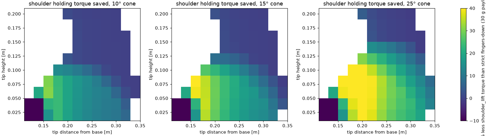
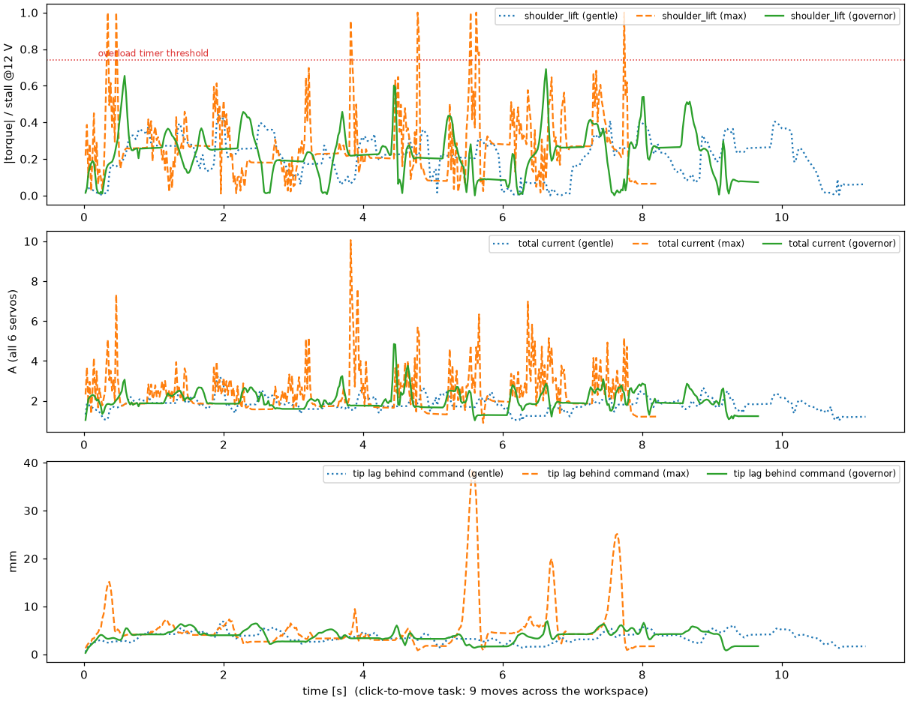

# Fast teleop study: torque governor + load-aware IK

Generated by `sim/scripts/fast_teleop_study.py`. Raw numbers: `sim/out/fast_teleop/report.json`. Interpretation: [FAST_TELEOP_FINDINGS.md](FAST_TELEOP_FINDINGS.md).

Servo model: HX-30HM at 12.0 V: stall 3.18 N·m, no-load 5.96 rad/s; overload timer above 2.35 N·m (80 % of rated stall), trips after 2 s. Position-loop stiffness: full voltage at 2° error. Wrist camera mounted (46 g).

## 1. Click-to-move (9 moves across the workspace, incl. a wide pan sweep)

| motion | IK | total move time | per move [s] | peak shoulder / elbow (of stall) | longest above overload threshold | trips | peak / mean current | max tip lag | tilt at targets |
|---|---|---|---|---|---|---|---|---|---|
| gentle | strict 0° | **8.5 s** | 1.02, 0.85, 0.65, 0.92, 0.68, 0.71, 0.99, 1.63, 1.05 | 44% / 74% | 0.00 s | 0 | 3.74 / 1.82 A | 6.9 mm | 11.3° |
| gentle | load-aware 15° | **9.04 s** | 0.95, 0.95, 0.78, 1.12, 0.65, 0.75, 1.12, 1.70, 1.02 | 44% / 100% | 0.02 s | 0 | 4.79 / 1.88 A | 9.2 mm | 12.6° |
| max | strict 0° | **5.51 s** | 0.61, 0.65, 0.54, 0.65, 0.51, 0.44, 0.61, 0.88, 0.61 | 100% / 100% | 0.05 s | 0 | 10.06 / 2.42 A | 38.7 mm | 11.2° |
| governor | strict 0° | **6.97 s** | 0.82, 0.78, 0.65, 0.78, 0.61, 0.61, 0.82, 1.09, 0.82 | 69% / 57% | 0.00 s | 0 | 5.11 / 1.99 A | 7.0 mm | 11.3° |
| governor | load-aware 15° | **7.51 s** | 0.85, 0.78, 0.88, 0.82, 0.61, 0.65, 0.88, 1.16, 0.88 | 70% / 55% | 0.11 s | 0 | 5.97 / 2.19 A | 10.1 mm | 12.6° |
| governor (wrong model: +20 % mass, 100 g unknown payload) | strict 0° | **6.97 s** | 0.82, 0.78, 0.65, 0.78, 0.61, 0.61, 0.82, 1.09, 0.82 | 88% / 65% | 0.05 s | 0 | 5.31 / 2.52 A | 9.3 mm | 11.0° |
| governor (wrong model: +40 % mass, 150 g unknown payload) | strict 0° | **7.0 s** | 0.82, 0.78, 0.65, 0.78, 0.61, 0.61, 0.82, 1.09, 0.85 | 100% / 71% | 0.07 s | 0 | 5.45 / 2.91 A | 13.0 mm | 10.8° |
| gentle (servo: full voltage at 0.5°, D 17 ms) | strict 0° | **8.06 s** | 0.92, 0.88, 0.65, 0.82, 0.61, 0.68, 0.99, 1.56, 0.95 | 100% / 100% | 0.00 s | 0 | 4.66 / 1.83 A | 2.3 mm | 11.7° |
| governor (servo: full voltage at 0.5°, D 17 ms) | strict 0° | **7.0 s** | 0.82, 0.78, 0.68, 0.78, 0.61, 0.61, 0.82, 1.09, 0.82 | 72% / 56% | 0.00 s | 0 | 5.27 / 1.98 A | 2.3 mm | 11.7° |
| gentle (servo: full voltage at 5.0°, D 17 ms) | strict 0° | **8.81 s** | 0.95, 0.99, 0.78, 0.95, 0.75, 0.68, 1.05, 1.56, 1.09 | 46% / 46% | 0.00 s | 0 | 3.32 / 1.82 A | 16.8 mm | 10.6° |
| governor (servo: full voltage at 5.0°, D 17 ms) | strict 0° | **7.21 s** | 0.82, 0.78, 0.68, 0.78, 0.61, 0.61, 0.88, 1.16, 0.88 | 62% / 53% | 0.00 s | 0 | 4.49 / 1.97 A | 15.9 mm | 10.5° |
| gentle (servo: full voltage at 2.0°, D 0 ms) | strict 0° | **9.08 s** | 1.02, 0.99, 0.82, 0.99, 0.75, 0.68, 1.16, 1.63, 1.05 | 57% / 35% | 0.00 s | 0 | 3.86 / 1.84 A | 8.3 mm | 11.3° |
| governor (servo: full voltage at 2.0°, D 0 ms) | strict 0° | **7.34 s** | 0.85, 0.78, 0.65, 0.78, 0.71, 0.61, 0.92, 1.19, 0.85 | 79% / 72% | 0.03 s | 0 | 6.21 / 2.04 A | 8.8 mm | 11.3° |

Click-to-move from a low pose (tip 3 cm up) to a target 10 cm away, gentle profile:

| click move | time on the table | overload trips | final tip error |
|---|---|---|---|
| old: joint goal jumps to the target | 1.67 s | 0 | 111.2 mm |
| new: straight line, paced by the arm | 0.0 s | 0 | 5.5 mm |

## 2. Keyboard streaming (target slides along a path)

| motion | IK | key speed | mean / max tracking error | catch-up after release | peak shoulder / elbow | longest above threshold | trips | peak / mean current |
|---|---|---|---|---|---|---|---|---|
| gentle | strict | 0.1 m/s | 6.6 / 18.3 mm | 0.02 s | 49% / 31% | 0.00 s | 0 | 2.75 / 1.69 A |
| gentle | load-aware | 0.1 m/s | 6.9 / 17.1 mm | 0.08 s | 48% / 36% | 0.00 s | 0 | 2.94 / 1.7 A |
| governor | strict | 0.1 m/s | 6.6 / 9.8 mm | 0.03 s | 74% / 75% | 0.01 s | 0 | 5.9 / 1.74 A |
| governor | load-aware | 0.1 m/s | 6.6 / 9.1 mm | 0.02 s | 76% / 72% | 0.02 s | 0 | 6.23 / 1.76 A |
| gentle | strict | 0.25 m/s | 36.6 / 112.1 mm | 0.16 s | 73% / 82% | 0.00 s | 0 | 4.55 / 1.75 A |
| gentle | load-aware | 0.25 m/s | 39.0 / 127.2 mm | 0.21 s | 73% / 89% | 0.01 s | 0 | 4.54 / 1.75 A |
| governor | strict | 0.25 m/s | 15.8 / 27.2 mm | 0.05 s | 74% / 75% | 0.01 s | 0 | 5.9 / 1.89 A |
| governor | load-aware | 0.25 m/s | 15.7 / 23.2 mm | 0.06 s | 76% / 72% | 0.02 s | 0 | 6.23 / 1.93 A |

## 3. Load-aware IK, static holding torque (30 g payload, tip in the x-z plane)

| tilt cone | mean / max shoulder_lift saving | mean / max elbow_flex change | worst shoulder torque | mean tilt used |
|---|---|---|---|---|
| 0° | 0% / 0% | +0% / +0% | 0.95 N·m (30% of stall) | 11.3° |
| 10° | 5% / 31% | +3% / +9% | 0.93 N·m (29% of stall) | 15.8° |
| 15° | 8% / 45% | +4% / +14% | 0.92 N·m (29% of stall) | 18.5° |
| 25° | 17% / 72% | +8% / +20% | 0.83 N·m (26% of stall) | 24.6° |

## 4. Choosing the 180°-equivalent wrist roll

Only 23% of the camera-safe roll range (-2.744 … 0.8 rad) has its 180° twin also inside the range. Where it does:

| target | roll → twin | shoulder torque | holding-cost saving |
|---|---|---|---|
| [0.3, 0.0, 0.06] | -2.69 → -2.69 | 0.8 → 0.8 N·m | 0.0% |
| [0.3, 0.0, 0.06] | -2.44 → 0.7 | 0.81 → 0.804 N·m | 4.4% |
| [0.25, 0.15, 0.03] | -2.69 → -2.69 | 0.809 → 0.809 N·m | 0.0% |
| [0.25, 0.15, 0.03] | -2.44 → 0.7 | 0.821 → 0.84 N·m | 0.2% |
| [0.22, -0.1, 0.08] | -2.69 → -2.69 | 0.582 → 0.582 N·m | 0.0% |
| [0.22, -0.1, 0.08] | -2.44 → 0.7 | 0.594 → 0.61 N·m | 2.3% |

