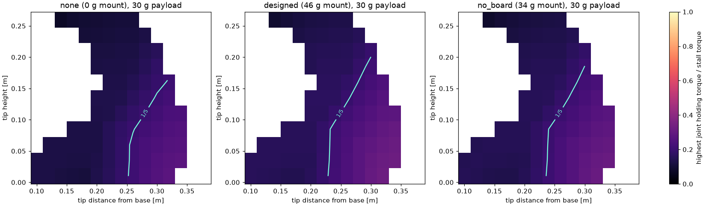
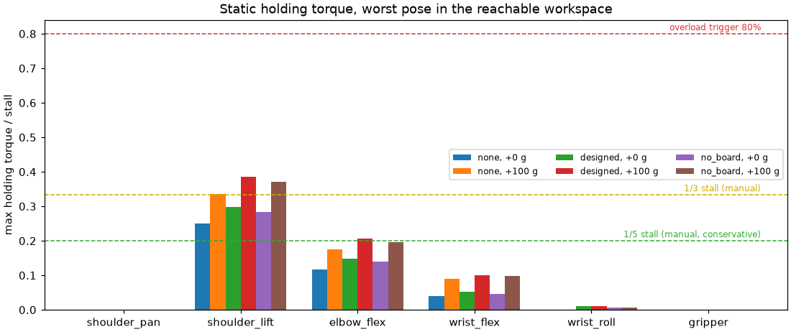
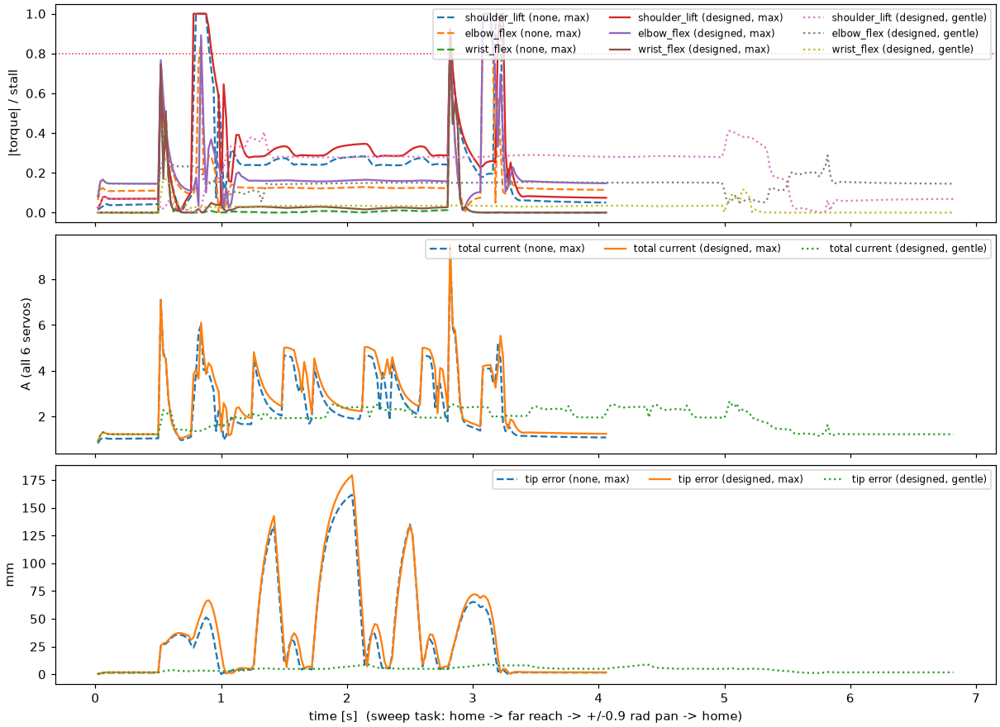

# Servo load study: can the HX-30HM carry the wrist camera?

Generated by `sim/scripts/servo_load_study.py`. Raw numbers: `sim/out/servo_study/report.json`.

Mount variants: none (0 g), as designed (46 g), board moved off the wrist (34 g).

Servo limits (HX-30HM): stall 2.94 N·m; overload protection trips when torque stays above 80 % (2.35 N·m) for 2 s and then caps output at 20 % (0.59 N·m); the manual recommends continuous load of 1/5–1/3 of stall (0.59–0.98 N·m).

## 1. Static holding torque (geometry + mass only; robust)

Highest holding torque per joint anywhere in the reachable workspace (fingers as close to down as reachable, wrist roll over its camera-safe range), as a fraction of stall:

| mount | payload | shoulder_pan | shoulder_lift | elbow_flex | wrist_flex | wrist_roll | gripper | workspace > 1/3 stall | > 80 % (trip) |
|---|---|---|---|---|---|---|---|---|---|
| none | 0 g | 0% | 25% | 12% | 4% | 0% | 0% | 0% | 0% |
| none | 30 g | 0% | 28% | 13% | 5% | 0% | 0% | 0% | 0% |
| none | 100 g | 0% | 34% | 18% | 9% | 0% | 0% | 2% | 0% |
| designed | 0 g | 0% | 30% | 15% | 5% | 1% | 0% | 0% | 0% |
| designed | 30 g | 0% | 32% | 16% | 7% | 1% | 0% | 0% | 0% |
| designed | 100 g | 0% | 38% | 21% | 10% | 1% | 0% | 13% | 0% |
| no_board | 0 g | 0% | 28% | 14% | 5% | 1% | 0% | 0% | 0% |
| no_board | 30 g | 0% | 31% | 16% | 6% | 1% | 0% | 0% | 0% |
| no_board | 100 g | 0% | 37% | 20% | 10% | 1% | 0% | 10% | 0% |

Worst case anywhere in the joint ranges (arm stretched out horizontally), shoulder_lift: none +0 g: 0.86 N·m (29%), none +100 g: 1.26 N·m (43%), designed +0 g: 1.01 N·m (34%), designed +100 g: 1.41 N·m (48%), no_board +0 g: 0.97 N·m (33%), no_board +100 g: 1.37 N·m (47%).

## 2. Dynamic, realistic servo model

Torque-controlled joints (`so101sim/servo_model.py`): voltage saturation, back-EMF speed limit, overload protection, current. Peak torque (worst joint), overload trips, tracking and current. `sat` = position error giving full voltage (the real servo's stiffness is unmeasured).

| profile | task | mount | sat | payload | peak torque (joint) | overload trips | max tip error | final droop | peak / mean current | pick |
|---|---|---|---|---|---|---|---|---|---|---|
| max | pick | none | 0.5° | 0 g | 100% (shoulder_pan) | gripper ×1 | 80.3 mm | 1.0 mm | 12.24 / 3.29 A | ✅ |
| max | pick | none | 2.0° | 0 g | 100% (shoulder_pan) | gripper ×1 | 81.3 mm | 2.4 mm | 12.21 / 3.19 A | ✅ |
| max | pick | none | 5.0° | 0 g | 100% (shoulder_pan) | gripper ×1 | 83.3 mm | 5.2 mm | 12.22 / 3.13 A | ✅ |
| max | pick | designed | 0.5° | 0 g | 100% (shoulder_pan) | gripper ×1 | 83.0 mm | 1.1 mm | 12.24 / 3.54 A | ✅ |
| max | pick | designed | 2.0° | 0 g | 100% (shoulder_pan) | gripper ×1 | 84.1 mm | 2.8 mm | 12.21 / 3.4 A | ✅ |
| max | pick | designed | 5.0° | 0 g | 100% (shoulder_pan) | gripper ×1 | 86.2 mm | 6.3 mm | 12.24 / 3.33 A | ✅ |
| max | pick | no_board | 0.5° | 0 g | 100% (shoulder_pan) | gripper ×1 | 82.2 mm | 1.1 mm | 12.24 / 3.46 A | ✅ |
| max | pick | no_board | 2.0° | 0 g | 100% (shoulder_pan) | gripper ×1 | 83.1 mm | 2.7 mm | 12.21 / 3.32 A | ✅ |
| max | pick | no_board | 5.0° | 0 g | 100% (shoulder_pan) | gripper ×1 | 85.3 mm | 6.0 mm | 12.22 / 3.26 A | ✅ |
| max | sweep | none | 0.5° | 0 g | 100% (shoulder_pan) | 0 | 158.1 mm | 0.8 mm | 12.2 / 2.43 A |  |
| max | sweep | none | 0.5° | 100 g | 100% (shoulder_pan) | 0 | 158.1 mm | 0.9 mm | 12.2 / 2.84 A |  |
| max | sweep | none | 2.0° | 0 g | 100% (shoulder_pan) | 0 | 162.2 mm | 1.5 mm | 12.2 / 2.37 A |  |
| max | sweep | none | 2.0° | 100 g | 100% (shoulder_pan) | 0 | 162.4 mm | 2.1 mm | 12.2 / 2.78 A |  |
| max | sweep | none | 5.0° | 0 g | 100% (shoulder_pan) | 0 | 159.4 mm | 3.1 mm | 12.2 / 2.23 A |  |
| max | sweep | none | 5.0° | 100 g | 100% (shoulder_pan) | 0 | 159.8 mm | 4.7 mm | 12.2 / 2.65 A |  |
| max | sweep | designed | 0.5° | 0 g | 100% (shoulder_pan) | 0 | 174.7 mm | 0.8 mm | 12.2 / 2.75 A |  |
| max | sweep | designed | 0.5° | 100 g | 100% (shoulder_pan) | 0 | 174.8 mm | 1.0 mm | 12.2 / 3.16 A |  |
| max | sweep | designed | 2.0° | 0 g | 100% (shoulder_pan) | 0 | 179.8 mm | 1.8 mm | 12.2 / 2.68 A |  |
| max | sweep | designed | 2.0° | 100 g | 100% (shoulder_pan) | 0 | 180.0 mm | 2.5 mm | 12.2 / 3.09 A |  |
| max | sweep | designed | 5.0° | 0 g | 100% (shoulder_pan) | 0 | 169.0 mm | 4.0 mm | 12.2 / 2.54 A |  |
| max | sweep | designed | 5.0° | 100 g | 100% (shoulder_pan) | 0 | 169.3 mm | 5.5 mm | 12.2 / 2.94 A |  |
| max | sweep | no_board | 0.5° | 0 g | 100% (shoulder_pan) | 0 | 168.9 mm | 0.8 mm | 12.2 / 2.66 A |  |
| max | sweep | no_board | 0.5° | 100 g | 100% (shoulder_pan) | 0 | 169.0 mm | 1.0 mm | 12.2 / 3.07 A |  |
| max | sweep | no_board | 2.0° | 0 g | 100% (shoulder_pan) | 0 | 175.4 mm | 1.7 mm | 12.2 / 2.59 A |  |
| max | sweep | no_board | 2.0° | 100 g | 100% (shoulder_pan) | 0 | 175.5 mm | 2.4 mm | 12.2 / 3.0 A |  |
| max | sweep | no_board | 5.0° | 0 g | 100% (shoulder_pan) | 0 | 166.9 mm | 3.7 mm | 12.2 / 2.45 A |  |
| max | sweep | no_board | 5.0° | 100 g | 100% (shoulder_pan) | 0 | 167.2 mm | 5.3 mm | 12.2 / 2.86 A |  |
| max | hold | none | 0.5° | 0 g | 100% (shoulder_pan) | 0 | 54.4 mm | 1.8 mm | 12.2 / 1.67 A |  |
| max | hold | none | 0.5° | 100 g | 100% (shoulder_pan) | 0 | 82.8 mm | 2.2 mm | 12.2 / 2.22 A |  |
| max | hold | none | 2.0° | 0 g | 100% (shoulder_pan) | 0 | 50.3 mm | 4.1 mm | 12.2 / 1.67 A |  |
| max | hold | none | 2.0° | 100 g | 100% (shoulder_pan) | 0 | 77.9 mm | 5.6 mm | 12.2 / 2.21 A |  |
| max | hold | none | 5.0° | 0 g | 100% (shoulder_pan) | 0 | 42.7 mm | 8.9 mm | 12.2 / 1.67 A |  |
| max | hold | none | 5.0° | 100 g | 100% (shoulder_pan) | 0 | 71.1 mm | 12.7 mm | 12.2 / 2.21 A |  |
| max | hold | designed | 0.5° | 0 g | 100% (shoulder_pan) | 0 | 69.1 mm | 2.0 mm | 12.2 / 1.95 A |  |
| max | hold | designed | 0.5° | 100 g | 100% (shoulder_pan) | 0 | 101.0 mm | 2.3 mm | 12.2 / 2.49 A |  |
| max | hold | designed | 2.0° | 0 g | 100% (shoulder_pan) | 0 | 65.7 mm | 4.8 mm | 12.2 / 1.95 A |  |
| max | hold | designed | 2.0° | 100 g | 100% (shoulder_pan) | 0 | 97.4 mm | 6.4 mm | 12.2 / 2.49 A |  |
| max | hold | designed | 5.0° | 0 g | 100% (shoulder_pan) | 0 | 58.4 mm | 10.8 mm | 12.2 / 1.95 A |  |
| max | hold | designed | 5.0° | 100 g | 100% (shoulder_pan) | 0 | 90.1 mm | 14.6 mm | 12.2 / 2.48 A |  |
| max | hold | no_board | 0.5° | 0 g | 100% (shoulder_pan) | 0 | 64.6 mm | 1.9 mm | 12.2 / 1.87 A |  |
| max | hold | no_board | 0.5° | 100 g | 100% (shoulder_pan) | 0 | 96.5 mm | 2.3 mm | 12.2 / 2.41 A |  |
| max | hold | no_board | 2.0° | 0 g | 100% (shoulder_pan) | 0 | 60.9 mm | 4.6 mm | 12.2 / 1.87 A |  |
| max | hold | no_board | 2.0° | 100 g | 100% (shoulder_pan) | 0 | 91.5 mm | 6.2 mm | 12.2 / 2.41 A |  |
| max | hold | no_board | 5.0° | 0 g | 100% (shoulder_pan) | 0 | 53.6 mm | 10.3 mm | 12.2 / 1.87 A |  |
| max | hold | no_board | 5.0° | 100 g | 100% (shoulder_pan) | 0 | 84.3 mm | 14.1 mm | 12.2 / 2.4 A |  |
| gentle | pick | none | 2.0° | 0 g | 100% (gripper) | gripper ×1 | 7.4 mm | 2.4 mm | 5.73 / 2.48 A | ✅ |
| gentle | pick | designed | 2.0° | 0 g | 100% (gripper) | gripper ×1 | 8.1 mm | 2.8 mm | 5.97 / 2.67 A | ✅ |
| gentle | pick | no_board | 2.0° | 0 g | 100% (gripper) | gripper ×1 | 7.9 mm | 2.7 mm | 5.89 / 2.61 A | ✅ |
| gentle | sweep | none | 2.0° | 0 g | 40% (shoulder_lift) | 0 | 8.5 mm | 1.5 mm | 2.58 / 1.62 A |  |
| gentle | sweep | none | 2.0° | 100 g | 50% (shoulder_lift) | 0 | 9.3 mm | 2.1 mm | 2.89 / 2.07 A |  |
| gentle | sweep | designed | 2.0° | 0 g | 45% (shoulder_lift) | 0 | 9.0 mm | 1.8 mm | 2.77 / 1.86 A |  |
| gentle | sweep | designed | 2.0° | 100 g | 55% (shoulder_lift) | 0 | 9.9 mm | 2.4 mm | 3.1 / 2.33 A |  |
| gentle | sweep | no_board | 2.0° | 0 g | 44% (shoulder_lift) | 0 | 8.9 mm | 1.7 mm | 2.71 / 1.79 A |  |
| gentle | sweep | no_board | 2.0° | 100 g | 54% (shoulder_lift) | 0 | 9.8 mm | 2.3 mm | 3.03 / 2.25 A |  |
| gentle | hold | none | 2.0° | 0 g | 40% (shoulder_lift) | 0 | 4.7 mm | 4.1 mm | 2.27 / 1.65 A |  |
| gentle | hold | none | 2.0° | 100 g | 50% (shoulder_lift) | 0 | 6.3 mm | 5.6 mm | 2.5 / 2.19 A |  |
| gentle | hold | designed | 2.0° | 0 g | 45% (shoulder_lift) | 0 | 5.6 mm | 4.9 mm | 2.32 / 1.92 A |  |
| gentle | hold | designed | 2.0° | 100 g | 55% (shoulder_lift) | 0 | 7.1 mm | 6.4 mm | 2.81 / 2.46 A |  |
| gentle | hold | no_board | 2.0° | 0 g | 44% (shoulder_lift) | 0 | 5.3 mm | 4.6 mm | 2.3 / 1.84 A |  |
| gentle | hold | no_board | 2.0° | 100 g | 54% (shoulder_lift) | 0 | 6.9 mm | 6.2 mm | 2.72 / 2.38 A |  |

